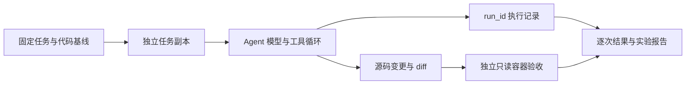

# 任务评测、执行记录与对照实验

四维汇总、20 题分层示例集、全量/冒烟策略和发布门禁见
[四维评测与优化闭环](FOUR_DIMENSION_EVALUATION.md)。本页原有 24 题使用 `--dataset legacy`（默认）。
默认评测最终方案 `summary_scheduled`（摘要＋依赖调度）。

公开环境另提供 [AgentBench FC 接入](AGENTBENCH.md)，使用官方任务、动作执行和评分，
结果独立保存。当前 FC 适配评测模型客户端与摘要上下文管理，不经过本地依赖调度器。

## 快速开始

安装项目后可使用 `xclaw-eval`、`xclaw-workspace`。未刷新安装时，用模块命令也可以运行：

```powershell
uv sync --group dev
uv run python -m xclaw.evaluation.runner --list
uv run python -m xclaw.evaluation.runner --self-check
```

自检不读取模型配置、不调用 API，只执行项目内维护的起始版本和参考实现。
内置 24 个合成 Python 任务：10 个 bug 修复、6 个功能实现、4 个多文件修改、4 个历史约束任务。
每个起始版本必须验收失败，参考实现必须验收成功，否则自检退出码为 1。
这只能证明评测夹具有效，不能用作 Agent 的成功率。

真实模型评测前先准备 Docker 与执行镜像：

```powershell
docker build -f Dockerfile.sandbox -t xclaw-sandbox:latest .
uv run python -m xclaw.evaluation.runner --config config.yaml --tasks clamp invoice context_decimal --repeats 1
```

这个命令是最终方案 × 3 个任务 × 1 次重复，共 3 次独立任务尝试。
运行会使用指定配置中的默认 Provider，产生实际 API 用量。先用小样本检查配置与产物，
再运行完整实验：

```powershell
uv run python -m xclaw.evaluation.runner --config config.yaml --repeats 3
```

完整评测是最终方案 × 24 题 × 3 次重复 = 72 次任务尝试，每次可能有多轮及辅助模型请求。
使用 `--dataset balanced` 则为最终方案 × 20 题 × 3 次重复 = 60 次。
可添加 `--concurrency 2` 同时执行两个独立任务；默认 1，上限 4。各版本评测保持相同的
任务并发度，实际数值保存在 experiment.json。并发会影响资源竞争和 API 延迟，比较时必须
保持该设置一致；它与单个任务内部的工具并发是两个不同维度。
缺少 Docker 或镜像时在调用模型前退出。基础设施或容器清理故障会停止后续任务。
任务自身的失败保留在结果中，不删除、不从分母剔除。Ctrl+C 时保留已完成结果和当前任务记录。
余额不足（HTTP 402）、认证与永久配置错误会快速失败并停止后续模型请求，
不把它们误记为上下文预算或代码验收失败。非瞬态 HTTP 错误不做客户端重复尝试。

## 最终方案与固定条件

产品验收固定使用 `summary_scheduled`。下表保留历史实验方案的定义；其他方案只有显式
传入 `--variants` 才会运行，日常评测不需要选择它们。既有历史记录不参与新方案的指标汇总。

| 方案 | 上下文 | 多工具调度 |
|---|---|---|
| summary_serial | 整轮/工具组摘要 | 保守串行 |
| summary_scheduled | 整轮/工具组摘要 | 模型依赖计划与运行时校验 |
| truncate_serial | 丢弃完整旧轮次/工具组 | 保守串行 |
| truncate_scheduled | 丢弃完整旧轮次/工具组 | 模型依赖计划与运行时校验 |

四种方案共用模型、temperature=0、起始代码、工具集、预算与验收脚本。
每次从独立副本开始；参考实现和独立验收脚本不在 Agent 的工作区中。
评测仅注册文件工具与 Bash，关闭长期记忆提取，减少实验中的额外变量。
依赖规划、摘要请求和 AIClient 重试都计入执行记录；Provider 内部的网络重试不单独展开。
每次重复轮换方案顺序，以减轻固定顺序影响；这不保证服务端完全确定性。

默认人为限制上下文窗口为 `min(Provider.context_window, 8192)`，用于触发长对话压缩。
这不是模型的真实窗口规格。可用 `--context-window 16384` 显式调整，不能超过配置窗口。
默认输出上限为 1024，轮次上限 12，任务超时 180 秒；输出与超时可以用
`--max-tokens`、`--timeout` 调整。实验清单保存实际设置、任务内容哈希和 Docker 镜像 ID。

通过 `--variants summary_serial summary_scheduled` 可只比较调度；
通过 `--variants truncate_scheduled summary_scheduled --tasks context_decimal context_case context_validation context_order`
可重点比较历史约束保留。
简单单文件任务常常没有并发机会，调度实验应重点观察多文件任务中的实际工具批次，
不能只用整体平均耗时证明调度有效。

### DeepSeek 辅助请求

DeepSeek 默认开启思考模式，推理会消耗辅助请求的输出预算；小样本运行发现摘要输出
在限制处结束，导致预算准备失败，调度也出现超时。Provider 对 DeepSeek 的摘要、调度、
记忆提取请求默认发送 `thinking.type=disabled`，主任务请求保持原模型行为。
该设置在 Provider 配置中为 `auxiliary_thinking: false`；设为 `null` 时不发送覆盖参数。
其他模型不发送该参数。参数依据见 [DeepSeek 官方思考模式说明](https://api-docs.deepseek.com/guides/thinking_mode)。
思考模式下 temperature 参数不影响采样，因此请求设置为 0 仍不表示完全确定性；重复实验
用于观察实际变化。正式报告应记录辅助请求策略，不能混合修改前后的结果。

## 验收与指标

成功同时要求：Agent 正常完成、独立验收成功、变更路径满足任务约束。
达到轮次上限、超时或运行时异常，即使最终源码碰巧通过检查，也不算完成成功。
验收使用另一个干净容器：工作区只读，验收代码挂载在独立只读目录。
验收不把隐藏检查反馈给 Agent，也不执行模型生成的源码于宿主机。
Agent 可通过 Bash 自行编写公开测试；这不能替代独立验收。
这一机制针对工程回归，尚不是防恶意参评程序欺骗验收的完整基准安全系统。

| 指标 | 口径 |
|---|---|
| success_rate | 验收成功且正常完成的尝试数 / 全部已记录尝试数 |
| median_seconds | Agent 执行耗时的中位数，包括模型、辅助请求及工具调用 |
| p95_seconds | 至少 20 次尝试时报告 nearest-rank P95；否则留空 |
| reported_tokens | 所有被记录请求中服务端返回的 Token 用量之和 |
| usage_complete | 每次请求都有用量才为真；缺失用量时 Token 仅为已知下界 |
| model_calls | 主调用、调度、摘要、记忆等 Provider 尝试次数，包括失败尝试 |
| tool_calls | 实际执行的工具数；依赖失败/延期调用另外记为 skipped |
| failures | 按预算失败、验收失败、超时、基础设施错误等分类 |

执行耗时与独立验收耗时分开保存。报告不推断货币费用，也不自动生成“提升 X%”的简历结论。
内置任务偏小且合成，真实模型结果也只能说明在这套任务和配置上的表现。

## 产物

每次实验输出到 `.xclaw/evaluations/<experiment-id>/`：

```text
experiment.json       # 数据集哈希、配置、镜像、计划/实际次数、完成状态
results.json          # 所有已完成尝试，包含失败
summary.json          # 汇总和分类结果
report.md             # 可阅读报告及失败记录链接
<task>-<variant>-<attempt>/
  seed/               # 起始代码
  oracle/validate.py  # 独立验收代码，Agent 不可见
  traces/*.jsonl      # run_id、模型/工具耗时、状态、依赖计划、压缩结果
  tasks/<id>/         # baseline/、work/、manifest.json、changes.diff
  response.txt        # 最终回复
  validation.json     # 验收 stdout/stderr、退出码
  result.json         # 本次状态与指标
```

服务/Demo 的元数据 trace 不记录提示词、模型回复、工具参数/结果或错误正文。
评测入口现在默认额外捕获模型请求/回复及工具参数/返回，可用 `--metadata-only` 关闭。
捕获大小限制、离线重算和版本检查见四维评测说明；它不是任务检查点。
最终回复、源码和 diff 继续作为独立产物。
流式请求会请求 OpenAI-compatible `stream_options.include_usage`；不支持该参数的服务
可使用非流式入口，或在 Provider 中适配。用量缺失不会被伪装成零消耗。

服务/Demo 默认将 trace 保存到 `agent.trace_dir: logs/traces`；设为 `null` 可关闭文件落盘，
仍可通过 `agent.last_trace.metrics()` 获取当前任务统计。

## 使用自己的仓库任务

准备一份固定代码副本和其外部的验收脚本。清单例子：

```json
{
  "tasks": [
    {
      "id": "real_bug_001",
      "category": "repository_bug",
      "prompt": "修复 src/parser.py 的空输入处理，并保留现有接口。",
      "fixture": "fixtures/parser-bug",
      "validator": "validators/parser-bug.py",
      "allowed_write_paths": ["src/**"],
      "history": []
    }
  ]
}
```

路径相对清单文件。fixture 支持 UTF-8 文本文件，限 10000 个文件/100MB；沿用任务副本的
目录/凭据排除规则。验收脚本必须位于 fixture 外部，避免泄露给模型。
脚本通过 `sys.argv[1]` 获取 `/workspace`，可以读取源码、执行断言或启动预先准备的测试。
全部检查通过后打印独占一行 `XCLAW_VALIDATION_OK:1` 并退出 0；其他情况均验收失败。
测试需要的依赖提前放入执行镜像。验收容器工作区只读，测试不可依赖写工作区。

```powershell
uv run python -m xclaw.evaluation.runner --suite path/to/suite.json --config config.yaml --repeats 3
```

自定义任务先自行确认起始代码会失败、正确修复会通过，再执行模型实验。
同一报告不能把不同数据集、模型版本或预算的结果当作严格对照。

## 项目展示



面试展示一条完整链路：任务输入 → 关键工具批次 → diff → 独立验收 → 指标与失败归因。
介绍对照实验时明确数据集、模型配置、样本数和统计口径，再讨论改进幅度。
