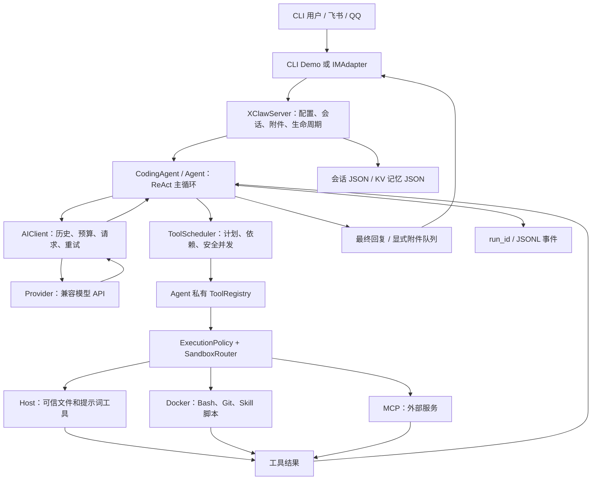
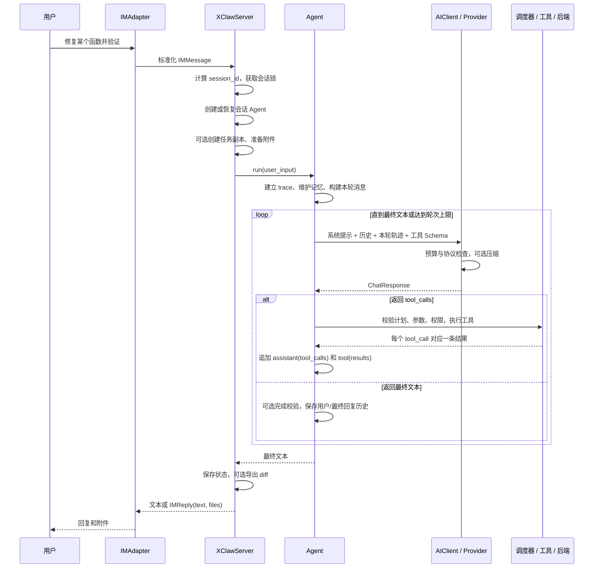

# XClaw 项目功能、实现原理、完整流程与面试问答

> 整理日期：2026-10-20。本文以当前 `src/xclaw/`、`skills/`、`tests/` 的代码和本地实验产物为依据。
>
> 阅读目标：既能回答“项目现在能做什么”，也能讲清“请求如何执行、为什么这样设计、哪里还没有完成”。面试回答中的“我”是参考话术，请根据自己的实际参与范围调整。
>
> 状态约定：**主链路已实现**表示已被服务或 Agent 调用；**可选能力**表示需要配置、依赖或外部平台支持；**原型模块**表示代码存在但尚未进入默认业务链路。历史评测结果不等于当前版本重新实测的结果。

## 目录

1. [项目定位与当前功能总览](#1-项目定位与当前功能总览)
2. [技术栈、目录与分层架构](#2-技术栈目录与分层架构)
3. [整体项目流程](#3-整体项目流程)
4. [逐项功能实现与面试问答](#4-逐项功能实现与面试问答)
5. [贯穿项目的面试追问](#5-贯穿项目的面试追问)
6. [测试、实验与可使用的数据](#6-测试实验与可使用的数据)
7. [运行、排查与演示路线](#7-运行排查与演示路线)
8. [尚未完成的能力与演进方向](#8-尚未完成的能力与演进方向)
9. [项目介绍参考话术](#9-项目介绍参考话术)
10. [源码与已有专题文档索引](#10-源码与已有专题文档索引)

## 1. 项目定位与当前功能总览

### 1.1 一句话解释

XClaw 是一个使用 Python / asyncio 实现的本地编程 Agent 原型。用户从命令行或即时通信机器人提出需求后，模型可以调用文件、Git、Shell、Skill 和 MCP 工具，完成“理解任务 → 读取信息 → 修改代码或生成文件 → 执行检查 → 返回结果”的闭环。

它的核心工作不是训练大模型，而是实现模型之外的运行时：消息组织、工具协议、执行权限、上下文预算、记忆维护、并发调度、文件交付、运行记录和独立验收。

“能修复 Bug、实现功能、分析项目”表示具备完成这些任务的工具链和循环机制；具体任务是否正确完成，仍取决于模型输出、环境依赖和验收结果。

### 1.2 当前功能清单

| 编号 | 功能 | 当前状态 | 用户或开发者能得到什么 |
|---|---|---|---|
| F01 | 配置加载、CLI Demo、服务启动 | 主链路已实现 | 用配置启动机器人或命令行交互 |
| F02 | OpenAI-compatible 模型接入 | 主链路已实现 | 用统一接口接入兼容服务，管理请求、重试和用量 |
| F03 | 流式响应聚合 | 已实现，入口使用有区别 | Demo 首轮可输出文本增量，聚合多个工具调用 |
| F04 | ReAct 编程 Agent | 主链路已实现 | 多轮思考、调用工具、观察结果和继续处理 |
| F05 | 工具注册、Schema 和参数校验 | 主链路已实现 | 把可信 Python 能力暴露给模型并统一执行 |
| F06 | 文件读取、编辑、创建、目录和搜索 | 主链路已实现 | 分析和修改工作区文件；删除需额外授权配置 |
| F07 | Bash 与 Git | 可选执行环境已接入 | 在 Docker 中运行命令、测试及 Git 操作 |
| F08 | 串行、并行、依赖工具调度 | 主链路已实现，可关闭规划 | 独立安全读取可并发，前置失败阻断依赖调用 |
| F09 | 执行权限与路径策略 | 主链路已实现 | view / edit / execute、能力声明、路径边界 |
| F10 | Docker 进程隔离与生命周期 | 主链路已实现，需 Docker | 禁网、资源限制、输出上限、超时和取消清理 |
| F11 | 完整请求预算与上下文压缩 | 主链路已实现，可关闭 | 保留本轮用户要求，压缩旧历史并校验工具配对 |
| F12 | 长期事实记忆与任务工作记忆 | 主链路已实现，可关闭自动提取 | 维护偏好和项目约束，更新、忘记、过期和持久化 |
| F13 | 多会话隔离与重启恢复 | IM 主链路已实现 | 每个私聊用户或群有自己的历史与记忆 |
| F14 | Markdown Skill 与目录技能包 | 主链路已实现 | 按需读取操作规范、参考资料和固定脚本 |
| F15 | Excel 本地工具与 Word / Excel Skill | 已实现，复杂处理需依赖与 Docker | 读取、创建、编辑、模板填充和数据合并 |
| F16 | 飞书机器人与附件闭环 | 已接入主链路，需平台权限 | 接收消息/文件，处理真实附件并发送最终文件 |
| F17 | QQ 机器人适配 | 接入代码已实现，需平台联调 | 统一文本消息入口与回复，连接、心跳和重连 |
| F18 | MCP 外部工具接入 | 可选能力已接入 | 发现并调用 stdio / Streamable HTTP 服务工具 |
| F19 | 独立任务副本、diff 和冲突回写 | 可选能力已接入 | 先在副本中修改，检查后显式回写原工作区 |
| F20 | 事件、日志、run_id 和用量追踪 | 主链路已实现 | 关联一次任务中的模型、工具、调度与压缩事件 |
| F21 | 独立验收和四方案对照实验 | 已实现独立评测入口 | 固定任务、隔离执行、客观验收、生成实验报告 |
| F22 | 四维模型评分、组件分析和回归校准 | 已实现独立质量评测入口 | 从相关性、准确性、完整性、有用性分析产物 |
| F23 | Planner、消息队列、Worker、内置守护监控 | 原型模块/程序接口 | 可复用基础组件，但不能描述为默认后台任务系统 |

### 1.3 当前本地配置与代码默认值

本次仅提取与功能有关的配置，不在文档中复制模型密钥、机器人密钥或历史会话内容。

| 项目 | 当前本地配置或回退行为 | 说明 |
|---|---|---|
| IM 入口 | 飞书 `websocket` | 当前配置选择飞书，不是同时启用所有平台 |
| 主任务最大输出 | `8192` | 来自当前 `config.yaml`；`AgentConfig` 默认是 4096 |
| 主循环轮次上限 | `10` | 这里是主循环轮次，不是最多只能执行十个工具 |
| 自动长期记忆 | 已开启 | 每轮主任务之前维护用户事实 |
| 上下文压缩 | 已开启 | 对完整请求做估算预算检查 |
| 执行模式 | 未显式设置，回退 `execute` | 允许进程能力，但仍需 Docker 可用 |
| 文件删除工具 | 未显式设置，默认关闭 | 不代表任意 Shell 已无法删除挂载目录中的文件 |
| 独立任务副本 | 未显式设置，默认关闭 | 当前普通任务默认仍直接操作配置工作区 |
| 工具依赖规划 | 未显式设置，默认开启 | 默认安全并发上限 4 |
| MCP 服务 | 当前配置 0 个 | 接入能力存在，但当前没有配置外部服务 |

服务配置默认开启记忆和压缩；直接用 Python 构造 `CodingAgent` 时，这两个构造参数默认都是 `False`。介绍“默认行为”时需要说明使用的是哪一个入口。

## 2. 技术栈、目录与分层架构

### 2.1 技术选型

| 技术 | 在项目中的具体用途 |
|---|---|
| Python ≥ 3.11 | 实现运行时、工具、服务和评测；使用 `asyncio.timeout` 等能力 |
| asyncio | 异步模型调用、IM I/O、工具批次执行、锁和子进程管理 |
| OpenAI Python SDK | 通过 `AsyncOpenAI` 使用兼容的 Chat Completions 协议 |
| Pydantic | 消息类型、配置、调度计划、Judge 输出结构校验 |
| httpx / websockets | 平台 API、附件传输、QQ 网关和远程 MCP 通信 |
| lark-oapi | 飞书官方长连接事件接入 |
| YAML / Markdown | 项目配置与 Skill 元数据、操作说明 |
| MCP SDK / jsonschema | 外部服务连接、工具发现、动态参数校验 |
| Docker | 模型生成命令的执行环境与独立验收环境 |
| python-docx / openpyxl | 可选 Office 文件处理依赖 |
| JSON / JSONL | 会话和记忆存储、任务元数据、逐条运行事件 |
| pytest / pytest-asyncio / Ruff | 自动化回归、异步测试与静态检查 |
| PM2 | 通过现有部署配置守护 Python 服务进程 |

### 2.2 关键目录

```text
XClaw/
├── src/xclaw/
│   ├── server/       配置、CLI、服务编排、会话与附件输入
│   ├── ai/           Provider、AIClient、流式聚合、预算、协议修复
│   ├── core/         Agent、工具、调度、记忆、任务副本
│   │   └── skill/    Skill 发现、按需正文、资源与脚本入口
│   ├── coding/       CodingAgent、文件、Bash、Git、Excel 工具
│   ├── sandbox/      权限策略、Host/Docker 路由、进程输出与清理
│   ├── im/           平台适配、飞书、QQ、显式附件交付
│   ├── mcp/          MCP 配置、连接管理、动态工具
│   ├── evaluation/   固定任务、独立验收、Judge、回归与校准
│   ├── mom/          EventBus，以及尚未接入主流程的 Queue/Worker
│   ├── pm2/          Python 守护和监控原型
│   ├── persistence.py 原子 JSON 写入
│   └── telemetry.py   run_id 和结构化执行记录
├── skills/           5 个单文件编码 Skill + Word/Excel 两个目录包
├── tests/            主链路与边界条件回归测试
├── docs/             专题说明、实验和验证记录
├── examples/         MCP 示例服务
├── sessions/         运行时会话历史和长期记忆
├── logs/             服务日志与可配置的 trace
├── .xclaw/           任务副本、评测和质量分析产物
├── Dockerfile.sandbox 执行镜像构建文件
└── pyproject.toml    依赖、入口和工具配置
```

`sessions/`、`logs/`、输入附件和实验产物属于运行数据，不是项目业务模块。目录中独立的 Java 文件或用户表格，也不能当作 XClaw 框架本身新增的业务能力。

### 2.3 整体架构图



这里有三种执行边界：可信宿主机函数、Docker 内进程、外部 MCP 服务。不能把所有工具都描述成“统一在 Docker 中执行”。

## 3. 整体项目流程

### 3.1 从启动到等待消息

1. 从 `pyproject.toml` 的 `xclaw` 入口进入 `server/main.py:main`，解析 `--config`、`--demo` 等参数。
2. `load_config` 优先读取显式文件，其次查找默认配置文件；均不存在才从环境变量和默认值构造配置。
3. 服务创建日志输出、`ProviderRegistry`、选定的 IM Adapter 和默认 `CodingAgent`。
4. `CodingAgent` 创建独立的工具注册表、权限策略、SandboxRouter、上下文和记忆组件。
5. 注册文件、Git、Bash、Excel 和 Skill；有文件交付能力的 IM 入口再注册 `deliver_file`。
6. `server.start()` 启动允许的 MCP 连接，发现工具并挂入 Agent 注册表。
7. 启动飞书或 QQ Adapter；注册退出信号；服务等待关闭事件。
8. Docker 不在普通初始化时立刻启动，第一次进程请求才惰性创建容器。

注意：源码中有 `ServerConfig.host/port/enable_cors` 和 HTTP 回调处理方法，但当前服务主流程没有真正绑定 HTTP 监听器。不能仅凭配置字段或顶部注释，就称项目已有完整 HTTP API 服务。

### 3.2 一条普通 IM 编程请求如何完成



同一会话锁覆盖服务处理任务、准备附件和生成回复。Adapter 的实际附件上传与消息发送发生在处理器返回之后，因此不能据此声称“整个网络交付阶段也被同一把会话锁覆盖”。

### 3.3 一次模型调用的数据组成

```text
完整请求 = 系统提示词
         + 持久历史（历史用户消息、最终回复、可能存在的摘要）
         + 本轮消息（注入记忆的用户输入、工具调用、工具结果）
         + 所有本轮暴露的工具名称、描述与参数 Schema
```

其中，工具实现函数不会发送给模型。模型根据定义选择能力并提供参数，框架负责真正执行。

历史与轨迹分离是重要设计：工具调用链在本轮可见，正常结束时只把原用户输入和最终回复追加到持久历史。这样下一次任务不用重发所有旧工具输出，但也意味着不能依靠会话 JSON 逐步重放之前的执行。

### 3.4 Excel 附件的输入与交付流程

输入路径：飞书 file 事件 → 保留 `message_id/file_key/name` → 清洗文件名 → 检查工作区写权限 → 下载到 `inputs/feishu/<标识>/` → `inspect_excel` 读取真实工作簿 → 模型根据数据处理。

输出路径：模型调用 `create_excel` 或 Skill 脚本 → 创建并检查真实文件 → `deliver_file` 显式加入本轮队列 → 服务再次检查路径与文件 → Adapter 上传 → 用 `file_key` 回复原会话。

`deliver_file` 成功只表示“附件已准备”，不是已发送。实际上传或发送失败时，用户会收到文件已生成但发送失败的提示。

### 3.5 启用任务副本后的流程

```text
原工作区实际内容
  → 过滤凭据、缓存、Git 元数据等
  → baseline/ + work/ + manifest.json
  → 为本任务创建临时 Agent，工具绑定 work/
  → 执行任务，输出 changes.diff / changes.json
  → 返回副本位置，保留现场
  → 用户显式 apply
  → 检查原工作区是否仍与基线一致
  → 无冲突时回写，有冲突则拒绝
```

每一轮副本重新基于原工作区创建。上一轮没有回写的修改不会自动带入下一轮，即使会话历史仍提到它。任务副本不是完整的分支协作系统，也不会继承原仓库提交历史。

## 4. 逐项功能实现与面试问答

### F01 配置、CLI 与服务生命周期

**功能和入口。** 支持 `xclaw --config ...` 启动机器人，支持 `--demo` 命令行交互；Demo 提供 `/quit`（也接受 `/exit`、`/q`）、`/reset`、`/tools`。服务模式在当前处理函数中支持 `/reset` 和 `/status`。服务按 `default_provider` 选择模型，当前 Demo 则直接使用配置中的第一个 Provider。

**实现。** `server/config.py` 用 Pydantic 把 Provider、Agent、IM、日志和 MCP 配置拆开。`XClawServer` 完成依赖组装和生命周期管理。关闭时设置退出事件，串行进入关闭锁，停止 Adapter，并清理 MCP、默认 Agent 和各会话的 SandboxRouter。当前 Demo 的历史与记忆主要在进程内维护，没有像 IM 服务那样自动按会话文件恢复。

**实现边界。** 配置文件和环境变量并不是逐字段叠加覆盖：一旦找到 YAML 就直接使用该文件解析结果。MCP 支持显式 `${NAME}` 展开；普通 IM 配置没有同样的通用展开机制。现有 `from_env` 的 QQ Token 映射与当前 `app_secret` 字段存在遗留不一致，QQ 部署宜以实际 YAML 字段为准并专项修正。

**源码：** `server/config.py` 的 `Config/load_config`；`server/main.py` 的 `XClawServer/main/run_demo`。

**Q1：为什么要把配置拆成多个模型，而不是直接读取字典？**

A：配置直接影响预算、权限、超时等运行行为。分组模型可以集中提供默认值和类型约束，例如并发上限、压缩比例和超时的合法范围。业务代码拿到的是具有明确字段的对象，能够减少散落的字典读取和隐式类型转换。但并非所有字段都已有完整交叉校验，不能说配置错误一定都在启动时被发现。

**Q2：热修改配置会立即生效吗？**

A：当前没有热更新机制，Provider、Agent 和策略在初始化时创建。修改配置后需要重启服务。将来可以对日志等级等无状态配置做热更新，但模型、容器和工作区配置需要明确切换期间旧任务的处理方式。

**Q3：服务如何做到优雅退出？**

A：通过关闭事件让主等待结束，再关闭网络客户端和执行后端。`_stop_lock` 与 `_stopped` 防止重复清理；容器后端会处理活动进程取消和销毁。当前不是完整的任务排空系统，飞书 SDK 线程退出也只有等待行为，不能称所有入口都已经实现可证明无遗漏的优雅停机。

### F02 模型适配、请求重试与协议兼容

**功能。** 使用统一的 `BaseProvider` 接口接入 OpenAI-compatible 服务，业务层不用直接依赖 SDK 响应对象。

**实现。** `OpenAIProvider` 用 `AsyncOpenAI` 构建请求，把响应转换为 `ChatResponse`、`ToolCall`、usage 等内部类型；`ProviderRegistry` 按名称保存实例。`AIClient` 组织请求、历史、预算和重试。非流式普通调用最多尝试 3 次，临时错误采用 1 秒、2 秒的指数退避；400、401、402、403、404、405、410、422 等永久 HTTP 错误直接抛出。SDK 内部可能另有网络重试，因此不能把这里的次数等同所有底层 HTTP 次数。

DeepSeek 异常 DSML 工具文本由 `normalize_tool_response` 处理：只有完整独立的工具调用块、已注册名称、合法参数才允许恢复为标准调用；混合正文、残缺格式等会进入纠正重试。`reasoning_content` 在需要时保留给兼容服务的消息回传，不直接作为用户最终回复。

**源码：** `ai/provider.py`、`ai/client.py`、`ai/types.py`、`ai/tool_protocol.py`。

**Q1：为什么不让 Agent 直接使用 AsyncOpenAI？**

A：我把网络协议适配和任务执行分开。Agent 只消费统一消息和响应，Provider 负责不同服务的序列化差异，AIClient 管理历史、预算和重试。这样 Fake Provider 可以直接驱动测试，也便于将来增加新的后端；但当前统一实现主要面向兼容协议，不代表任意厂商原生 API 都已支持。

**Q2：为什么不能对所有模型错误都重试？**

A：余额不足、密钥错误和参数错误通常不会因为等待就恢复。重复请求会浪费时间，还可能让评测继续产生不可评价记录。当前对指定永久状态快速失败，临时故障才退避。将来可以细分限流、超时，并利用 Retry-After 与重试抖动。

**Q3：为什么不能直接把模型正文里的函数调用当代码执行？**

A：正文可能只是示例，也可能混入任意指令。这里优先使用标准 `tool_calls`；协议恢复只接受受约束的完整格式，并验证工具名与 Schema，最终仍走 ToolRegistry 和权限路由。它是特定协议兼容机制，不是自然语言转任意执行。

### F03 流式输出与工具调用聚合

**功能。** 支持普通流式模型响应，聚合文本、推理字段、工具调用和 Token usage。

**实现。** Provider 按工具索引建立缓冲区，累积工具名和 JSON 参数碎片；`StreamAccumulator` 汇总返回的状态，供 Agent 得到完整 `ChatResponse`。资源通过 `aclosing` 管理。

**实际入口。** `Agent` 只在设置回调的首轮走流式，后续轮次走非流式；IM 服务当前传入 `stream_callback=None`。DeepSeek 路径为了防止跨片段协议标记泄露，会先调用非流式 `chat`，再返回一个聚合块。因此不能宣称所有模型、所有工具轮次都在逐字实时输出。

**源码：** `ai/provider.py:chat_stream`、`ai/streaming.py`、`core/agent.py:_think_stream`。

**Q1：工具调用的 JSON 还没生成完时为什么不能执行？**

A：参数可能跨多个片段，一个片段既不一定是合法 JSON，也不一定是模型最终参数。必须按调用索引聚合到完整调用，再经过正常参数与权限检查。文本增量可以展示，但执行行为不能依赖半截参数。

**Q2：同一片段出现多个工具调用时如何避免串线？**

A：按 Provider 返回的索引分别保存工具状态。不同调用的参数各自累加，聚合器按对应调用保存最终快照，不能把所有片段拼成一个字符串，也不能把已经累计过的字段重复追加。

**Q3：流式请求的取消与统计有什么区别？**

A：消费者可能在结束之前取消迭代，因此需要关闭异步生成器，并在 finally 中记录状态。usage 也可能只在尾部出现，中途取消时不能假设已获得完整 Token 用量。项目的 trace 把缺失 usage 标记出来，而不是记成零消耗。

### F04 ReAct 主循环与任务完成判定

**功能。** 模型根据任务与工具结果迭代行动，而不是一次输出静态答案。

**实现步骤。** `Agent.run` 拒绝同一实例重入，创建 `RunTrace`，初始化状态；`_run` 清空 WorkingMemory、维护长期记忆、构建输入。每轮调用模型，有 `tool_calls` 就调度执行，按 `assistant(tool_calls) → tool(results)` 顺序回填，没有调用则取文本为最终回复。可选的 `completion_validator` 返回纠正提示时会继续循环。正常结束只持久追加用户输入与最终回复。

达到轮次上限后标记 `round_limit`，可能再调用一次无工具总结；这次总结不表示正常完成。一个循环轮次可以包含多个工具，额外还有记忆、调度、压缩等模型请求。

**已知不足。** 主循环主要按是否有工具调用判断结束，尚未全面把 `finish_reason=length` 或空文本识别为未完成。这也是历史评测复盘中明确发现的问题。

**源码：** `core/agent.py:run/_run/_act`、`coding/coding_agent.py`。

**Q1：ReAct 与写死工作流有什么不同？**

A：写死工作流提前指定动作顺序；这里由模型根据观察决定下一步读哪个文件、改哪里、运行什么检查。框架固定的是协议与执行边界，而不是每个任务的操作序列。它更灵活，也带来不可预测性，所以需要轮次、预算、超时和独立验收。

**Q2：框架如何知道代码修好了？**

A：普通运行时只能根据模型终止、工具结果和可选完成校验判断流程是否结束，不能证明业务正确。真实正确性由测试、diff 审查或独立评测判断。评测中的成功同时要求正常完成、独立验收通过、修改路径合规。

**Q3：模型反复调用同一个工具怎么办？**

A：当前用最大轮次限制最坏运行长度，trace 可以分析重复参数调用，但没有在线重复调用拦截或状态指纹止损。未来应结合工具名、规范化参数和工作区版本判断是否重复无进展，不能只因两次相同读取就误拦正常验证。

### F05 工具注册、参数 Schema 与统一执行

**功能。** 支持装饰器注册和 `add_tool`，把文件、进程、Skill、外部服务适配成统一工具定义。

**实现。** `Tool` 保存名称、描述、参数 Schema、可信执行函数、能力集合、路径参数、进程请求构建器和并发安全标记。普通工具通过 `inspect.signature/get_type_hints` 推导基础类型 Schema。执行时先解析 JSON 对象，再检查未知字段、基础类型和函数签名，填充默认值。Python 中 `bool` 是 `int` 子类，因此显式排除把布尔值当整数参数。

`CodingAgent` 为每个实例创建独立 ToolRegistry，并绑定自己的 SandboxRouter；不能依赖全局“当前工作区”。模型看到的只有定义，不会看到 `func` 的源码。

**边界。** 普通本地工具的自动 Schema 与校验主要覆盖基础类型和签名，不是支持所有复杂 Python 类型的完整验证器。MCP 使用独立的完整 JSON Schema 校验路径。

**源码：** `core/tool.py:Tool/ToolRegistry`、`coding/coding_agent.py`。

**Q1：Schema 已发给模型，为什么执行前还要校验？**

A：Schema 是模型生成参数的约束提示，不能保证返回数据一定合法。执行前必须重新检查；否则字符串代替布尔值、额外字段、非对象 JSON 都可能进入底层函数。模型输出始终是外部输入。

**Q2：为什么要用私有注册表？**

A：文件工具绑定工作区和策略。如果多个 Agent 复用可变全局注册表，后创建的工具可能覆盖前者，使会话 A 操作会话 B 的目录。每个 Agent 私有注册表能隔离绑定状态。Provider 和部分 MCP 连接可以共享，但历史、策略和本地工具绑定需要独立。

**Q3：空注册表为什么不能写成 registry or global_registry？**

A：ToolRegistry 实现了 `__len__`，空表会被判定为 False。这样传入的私有空表会意外回退全局对象。代码采用显式 `is not None`，保留调用者传入的空实例，这是一个容易破坏隔离的 Python 真值陷阱。

### F06 文件理解、搜索与精确编辑

**功能。** `read_file` 支持带行号和行范围；`list_directory` 列目录；`search_in_files` 支持文件模式、正则和大小写控制；`write_file` 创建或覆盖；`edit_file` 精确替换；`delete_file` 删除普通文件，但默认不暴露。

**实现。** Router 把路径解析到 Agent 工作区，校验允许和禁止路径。文件工具再用绑定的 ContextVar 校验递归访问目标，防止目录列表和搜索返回受限文件。读取尝试 UTF-8、GBK、Latin-1；编辑要求 UTF-8。`edit_file` 默认要求目标字符串只出现一次，重复时返回错误，除非显式 `replace_all=true`。

读目录、搜索、读取等阻塞 I/O 通过 `run_blocking/to_thread` 执行。搜索展示最多 50 条匹配，但实现仍可能遍历更多内容，并不表示底层扫描成本也限制在 50 条。

**源码：** `coding/file_tools.py`、`sandbox/policy.py`、`core/concurrency.py`。

**Q1：为什么用字符串替换而不是直接按行号编辑？**

A：行号会随其他修改漂移。以旧内容加上下文唯一定位，可以在目标已经变化时明确失败，避免静默改错位置。但它不是语法树级重构，编码变化、换行变化或多处相同文本仍需模型重新读取和定位。

**Q2：如何防止 ../ 或符号链接逃逸？**

A：对目标 `resolve()` 后验证仍在工作区内，再匹配策略路径；递归遍历也逐项校验。它能阻止常见路径跳转，但这是应用层检查，不等同操作系统级无竞态隔离，任意进程能力还有不同边界。

**Q3：现有文件写入是否都是原子的？**

A：不是。会话持久化、任务回写和 Excel 有临时文件与替换机制，普通 `write_file/edit_file` 仍直接写文本。要进一步提高可靠性，可以统一原子写入，并加入读时版本哈希检查；不能把一个模块的保证推广到所有文件操作。

### F07 Bash、Git 与实际运行验证

**功能。** Bash 可运行测试、脚本和检查命令；Git 提供 status、diff、log、branch、commit、checkout。它没有单独内置 push/PR 工具。

**实现。** Bash 构建 `RunProcess(shell=...)`；Git 构建固定 argv 请求，提交可组成 `add → commit` 的 `ProcessPlan`。Router 授权后统一交 Docker 后端执行。固定 Git 查看操作有专门白名单，关闭 hooks、pager、fsmonitor；diff 禁用 external diff 与 textconv。计划前一步失败即停止。

虽然工具名为 `bash`，当前容器通用 Shell 请求实际通过 `sh -c` 执行，需要 Bash 特性的命令应显式调用 bash。容器禁网，不能据工具描述中的“安装依赖”就认为运行时能联网安装依赖。

**源码：** `coding/bash_tool.py`、`coding/git_tools.py`、`core/execution.py`。

**Q1：Git 为什么不直接拼接 shell 字符串？**

A：分支名和提交信息来自模型参数。argv 可以把参数当作单独值传递，降低 shell 元字符注入风险；再对分支名和计数等校验。Git 自身还可能通过 hooks、external diff 执行外部代码，所以固定查看命令也要禁用这些扩展行为。

**Q2：危险命令黑名单足够安全吗？**

A：不够，字符串黑名单很容易被变形、脚本或其他语言绕过。它只是辅助防误操作。真正的边界是 PROCESS 权限、受限容器、最小挂载目录、资源上限和独立任务副本。

**Q3：Docker 不可用时会在本机继续跑吗？**

A：不会。进程请求失败会返回错误，不降级到宿主机执行模型命令。这样功能可用性会降低，但不会因为环境故障悄悄改变安全边界。可信的本地 Excel 和结构化文件工具仍有自己的宿主机执行路径。

### F08 工具串并行与依赖调度

**功能。** 同一批工具调用可串行、并行或按依赖 DAG 执行；不是跨整个任务的自动 DAG 规划。

**实现。** 多于 1 个且不超过 32 个调用时，调度器可用独立 AIClient 请求 JSON 计划。Pydantic 与 `validate_calls` 检查调用 ID 恰好覆盖、依赖存在、没有重复、自依赖和环。默认规划超时 10 秒，失败回退保守串行。

代码不允许模型新增工具、替换参数或伪造前置结果。若参数依赖尚未知的结果，`defer=true` 返回未执行结果，让主模型下一轮根据真实观察重新发起。前置失败或延期时，依赖调用跳过；独立调用仍可执行。最终结果按原始调用顺序回填。

并发还需要可信工具显式 `parallel_safe`，能力只能属于 FILE_READ / PROMPT，且没有进程请求构建器。写操作、进程、MCP 等不能因模型说“并行”就获得并发权限。文件交付还会被代码补充同路径写入/检查前置依赖。

Router 内另有写者优先读写门：安全读取共享，其他操作独占。`run_blocking` 在取消时等待实际线程退出后再释放锁，防止后台读取尚未结束就开始写入。

**源码：** `core/scheduling.py`、`core/concurrency.py`、`sandbox/router.py`。

**Q1：为什么不能直接 asyncio.gather 所有工具？**

A：读取不同文件通常独立，但“写文件后测试”“生成后交付”存在依赖。全部 gather 会产生竞态。当前先校验语义计划，再按可信副作用声明筛选并发批次，依赖成功后才调度下游。

**Q2：为什么既要 LLM 规划，又要程序校验？**

A：模型更适合判断自然语言任务中的语义依赖，程序更适合保证图结构和权限规则。两者职责不同。程序能拒绝有环计划和越权并发，但无法证明所有语义依赖都识别正确，因此要保守回退，并用实际评测检验收益。

**Q3：串行回退是不是遇到一个失败就不执行后面所有工具？**

A：不是。串行只说明不同时执行。只有声明依赖的调用才会因前置失败跳过；后面独立操作仍可能执行。不能把执行顺序与逻辑依赖混为一谈。

**Q4：这个调度器提升了多少速度？**

A：现有受控实验没有证明加速，短读取任务中额外模型规划成本反而抵消并发收益。当前价值主要是依赖检查、失败传播和保守副作用控制。后续应在慢 I/O 场景评测，并考虑对简单批次采用规则规划来减少模型调用。

### F09 执行权限、能力声明与路径策略

**功能。** 将“允许做什么”与“在哪里执行”分开，提供三种权限模式。

| 能力 | view | edit | execute |
|---|---|---|---|
| 提示词、结构化文件读取 | 允许 | 允许 | 允许 |
| 固定 Git 查看 | 允许，Docker 只读挂载 | 允许，Docker 只读挂载 | 允许 |
| 文件创建/编辑 | 拒绝 | 允许，Host 执行 | 允许，Host 执行 |
| 任意进程、Git 写操作、Skill 脚本 | 拒绝 | 拒绝 | 允许，Docker 执行 |
| MCP | 拒绝且不启动连接 | 拒绝且不启动连接 | 可按配置接入 |
| 独立文件删除工具 | 拒绝 | 需单独开启 | 需单独开启 |

**实现。** 工具声明 Capability，`get_all_definitions` 只给模型当前允许的工具。执行时再次 `authorize`，然后绑定参数、检查路径、构建请求和选择后端。未声明能力的工具默认拒绝。`read_paths/write_paths/denied_paths` 采用工作区相对路径匹配，结构化文件工具禁止写 `.git` 元数据。

**边界。** Python 工具函数与请求构建器是可信应用代码；这不是恶意 Python 插件隔离。路径 glob 不能限制任意 Shell 内的文件访问。PROCESS 开启后，挂载目录中的文件可能被代码直接读取、修改或删除。

**源码：** `core/execution.py`、`sandbox/policy.py`、`sandbox/router.py`。

**Q1：为什么同时在工具暴露和执行前检查权限？**

A：暴露过滤降低模型误选概率，执行前检查才是实际边界。历史调用、手工构造请求或模型异常仍可能引用隐藏工具，所以不能只靠不给模型看名称来控制能力。

**Q2：edit 模式为什么能写文件，却不能运行一个“只读脚本”？**

A：结构化写工具的路径和行为可预先约束，而任意脚本的真实副作用难以由名称判断。Skill 脚本也统一声明进程能力，包括 inspect。代码选择保守权限，而不是信任脚本名字含“读取”。

**Q3：关闭 delete_file 能否保证文件不被删除？**

A：不能，它只关闭结构化删除入口。execute 模式的任意代码仍可能删除可写挂载目录内文件。因此应结合副本与最小挂载，而不是把工具开关解释为容器内所有访问的系统策略。

### F10 Docker 隔离、超时、输出限制与清理

**功能。** 把模型控制的进程放入受限容器，统一管理启动、复用、取消和销毁。

**实现。** 容器 `sleep infinity` 保持运行，调用时 `docker exec`；挂载工作区到 `/workspace`，Skill 目录另行只读挂载到 `/opt/xclaw-skills`。限制 1GB 内存、1 CPU、128 PID，禁网、移除 capabilities、开启 no-new-privileges。启动锁避免重复创建，执行锁限制同一后端并发进程。

`capture_process` 同时读取 stdout/stderr 并等待退出，每个流按 UTF-8 字节限制缓冲；超过上限后继续排空，避免子进程因管道写满而阻塞。超时先终止本地 CLI，再由 Docker 后端销毁容器以停止内部进程。取消也走清理；清理失败标记 unhealthy，拒绝继续复用，并保留无法确认终止的事实。

启动中断时先检查 `xclaw.owner` 标签，避免删除同名的其他容器。容器停止后后端进入 closed 状态，拒绝新任务；超时销毁但未整体关闭的后端可在后续调用重建容器。

**源码：** `sandbox/docker.py`、`sandbox/process.py`、`sandbox/base.py`。

**Q1：杀掉 docker exec 客户端是否就结束了容器里的任务？**

A：不能保证，本地客户端与容器进程不是同一个生命周期。当前超时或取消会进一步销毁所属容器。如果删除失败，会明确标记不健康，不能假装里面的进程已经停止。

**Q2：为什么限制输出后仍要持续读取？**

A：如果达到限制就停止读，子进程可能阻塞在写 stdout/stderr，主进程又等待它退出，形成死锁。实现只停止保留新字节，仍持续排空两个管道。

**Q3：Docker 是否意味着宿主机源码绝对安全？**

A：不是。进程环境与宿主机隔离，但可写目录挂载共享文件内容。模型命令对挂载文件的破坏会反映到宿主机。需要独立副本来保护原工作区；容器隔离和文件版本保护解决不同问题。

### F11 上下文预算、整轮摘要与协议完整性

**功能。** 在发送主请求之前检查完整输入预算，超限时优先保留本轮要求，压缩旧信息；无法容纳则阻断发送。

**预算公式：**

```text
输入预算 = floor((context_window - max_tokens - safety_margin) × trigger_ratio)
```

预算包含系统提示、历史、本轮记忆与轨迹、工具 Schema；输出预留不能小于实际生成上限。当前使用字符/CJK 混合估算，不是模型官方 tokenizer。

**处理顺序。** 先检查不可压缩的用户输入、系统提示和工具定义；这些本身超限就直接失败。之后按完整用户轮次摘要历史，逐步减少保留数量；再摘要本轮较早的完整工具组，固定保留本轮原始输入；必要时对超大工具结果保留首尾并标记截断。调用参数、名称、ID 不被截断。最后再次验证预算和调用结果配对。

工具组要求调用 ID 非空、不重复，结果 ID 对应、没有未知或重复结果，每个调用都有结果。预算失败抛出 `ContextBudgetExceededError`，协议错误抛出 `ContextProtocolError`。处理使用临时列表，失败或取消时不提交临时历史。每次主请求准备最多 8 次摘要调用，单次摘要超时 30 秒；异常、空白、超长或更长的“压缩结果”不直接采用。

`summary` 和 `truncate` 共用预算与配对校验，后者丢弃旧整轮/工具组作为评测基线。关闭压缩后，这套预算准备逻辑不启用。

**源码：** `ai/context.py`、`ai/client.py:_prepare_messages`。

**Q1：为什么不能直接 history[-N:]？**

A：可能留下没有用户问题的助手回答，或把工具调用与结果拆开导致接口拒绝。还会遗漏系统提示和工具 Schema 的预算。当前按用户轮次和工具组切分，对完整请求核算。

**Q2：摘要能否保证所有约束都不丢失？**

A：不能。本轮原文是程序固定保留，旧历史摘要仍依赖模型语义。结构检查能保证配对合法，不能证明每个旧约束都保留。项目用历史约束任务和独立语义探针评估这件事。

**Q3：为什么压缩失败要回滚，而不是保存已经压缩的部分？**

A：一次请求准备需要形成整体合法状态。保存中间结果可能丢掉上下文，却仍然发不出去。临时修改通过最后校验才提交，可以避免错误请求污染后续历史；已经发出的摘要模型用量无法回滚。

**Q4：估算预算不超限能保证 API 不报上下文错误吗？**

A：不能。不同模型的 tokenizer、协议开销可能不同。当前通过安全余量降低风险，并阻断明显超限；要更精确，需要接入对应模型计数器或用真实 usage 持续校准，不能宣称零误差。

### F12 长期记忆更新、遗忘和作用域

**功能。** 保存长期偏好、项目事实与约束；默认不因超过固定条数淘汰旧事实，支持同键替换、忘记、过期、坏数据清理。WorkingMemory 保存本任务临时状态，每次运行开始清空。

**实现。** 自动记忆在主任务之前执行，把本轮用户原文和候选已有事实交给模型，产生最多 10 个 `upsert/forget` 操作。每项必须逐字引用当前原文连续片段；程序检查动作、作用域、字段和引用。删除只能指向提供过的已有事实。助手回复不能充当事实更新依据。

有效事实由 `(scope, key)` 标识，项目作用域使用原工作区绝对路径；用户偏好使用该会话内共享作用域。副本 Agent 沿用原项目作用域，防止临时目录生成新项目身份。JSON 加载会去重、过滤无效和过期条目；过期的新值不会让旧值“复活”。

存储和注入分别限制：底层默认不限条数，Prompt 默认最多 6000 字符，只注入可容纳的较新条目，省略不等于删除。自动维护候选有长度和预算限制。

**源码：** `core/memory.py`、`core/memory_extractor.py`、`core/agent.py:_extract_memories`。

**Q1：记忆与对话历史为什么要分开？**

A：历史是对话发生过什么，长期事实是当前仍有效的偏好和约束。历史摘要可能遗漏事实，事实值也可能被用户更新。独立 KV 能明确替换和撤销，但不替代完整对话或原始变更审计。

**Q2：原来是 Python，用户改成 Java，怎么避免两个要求同时生效？**

A：模型应沿用原来的 key 和作用域输出 upsert；存储层在同作用域同键下替换旧值。下一次注入只有新值。如果用户说“也支持 Java”，则是补充，不应删除 Python；这个语义区别仍依赖模型，不能用结构校验代替语义准确率。

**Q3：有原文引用是不是就能防住记忆污染？**

A：引用验证能拒绝不存在的证据和助手自造事实，但无法证明模型正确理解了原文。问题、假设和补充可能被误解。因此当前用受约束的操作集合和失败保留原记忆降低风险，还需要真实语义样本和人工标注评测。

**Q4：无限存储为什么不会无限占用上下文？**

A：存储数量和每次注入预算独立。当前限制注入字符和维护候选。缺点是很旧的相关事实可能进不了候选，因此大规模应用还需要检索；当前没有向量数据库、Embedding 或语义召回系统。

### F13 会话隔离、串行执行与重启恢复

**功能。** 私聊按用户、群聊按群隔离 Agent，保存历史与长期记忆，重启后收到消息时惰性恢复。

**实现。** `session_id` 为 `private-<sender_id>` 或 `group-<chat_id>`；服务维护 `_sessions` 和 `_session_locks`。每个会话有自己的历史、记忆、私有注册表与后端。同会话处理串行，避免同一 Agent 重入或两轮状态混合。

状态分别保存为 `sessions/<sid>.json` 和 `<sid>.memory.json`，`atomic_json` 使用临时文件、flush/fsync 与替换，降低半写文件风险。恢复失败会记录错误并使用新状态；`/reset` 清空历史、长期记忆和工作记忆，并保存。

**边界。** 两份会话 JSON 不是联合事务。执行轮次和工具结果另由 [Checkpoint](CHECKPOINTS.md) 保存，支持显式恢复。不同会话仍可能操作同一原工作区，各自的 Router 锁不能提供跨会话文件事务。会话缓存和锁也没有完整的容量淘汰机制。

**源码：** `server/main.py:_session_id/_get_or_create_agent/_handle_im_message`、`persistence.py`。

**Q1：群聊为什么不按发送者隔离？**

A：当前产品选择群作为共享协作上下文，所以不同成员会看到同一个群会话状态；私聊按人独立。若需要群内个人隐私或并行任务，应设计群+用户或群+线程键，不能声称现有群记忆是每个人私有的。

**Q2：这是不是断点续传？**

A：会话历史只恢复已完成对话；现在另有轮次级 Checkpoint，保存上下文、轮次、调度计划和工具结果，重启后可通过 `/resume <id>` 显式继续。已完成调用不重放，结果不确定的 Bash/写入等暂停核对，不恢复进程内部执行位置，也不保证外部副作用恰好一次。

**Q3：原子写文件为什么还不等于事务？**

A：替换只保证单文件更新更完整。历史写成功、记忆写失败时，两个文件仍可能来自不同时间点。多进程同时写同一会话也没有数据库级并发控制。生产化可以采用事务数据库或有版本的单一状态快照。

### F14 Markdown Skill、渐进加载与固定脚本

**功能。** 内置 7 个 Skill：`analyze-project`、`code-review`、`fix-bug`、`implement-feature`、`project-init`、`word`、`excel`。前五个提供编码步骤规范，后两个带资源和脚本。

**实现。** SkillLoader 优先发现 `skills/*/SKILL.md`，兼容 `skills/*.md`，不递归把参考资料当技能。启动只读 frontmatter，校验名称、描述、目录一致性等，再注册为 PROMPT 工具。模型最初看到简介与参数；调用后才读取完整正文。

`read_skill_resource` 按已注册技能目录分段读取文本，限制路径和大小。`run_skill_script` 只运行 metadata 声明的 `scripts/*.py`，用固定 `python -I -B` 与 argv 在 Docker 执行，不接受任意脚本路径。Skill 的 tools_needed 只提示依赖，不提升权限；技能包随 wheel 分发。

**源码：** `core/skill/skill_loader.py`、`executor.py`、`__init__.py` 和 `skills/`。

**Q1：Skill 与普通工具有什么区别？**

A：普通工具执行一个具体动作；Skill 主要把领域操作流程和参考资料按需交给模型。调用 Skill 本身通常只返回说明，后续还需要模型选择文件或脚本工具完成任务。它不是一个加载后自动跑完的独立子 Agent。

**Q2：渐进加载节省的是什么？**

A：初次请求只携带技能简介，不把全部正文和参考资料都塞进系统提示。需要时才读正文，再按需读资源。普通工具的 Schema 仍会发给模型，所以这不是所有工具定义都完全按需加载。

**Q3：用户能通过改 Skill 声明获得 Bash 权限吗？**

A：不能。Skill 是待使用的说明，实际权限来自工具的可信能力声明与 ExecutionPolicy。edit/view 下即使读到“运行脚本”的步骤，执行器仍会拒绝进程调用。

### F15 Excel 本地工具与 Office 文件处理

**功能。** `create_excel` 在宿主机可信代码中创建简单 `.xlsx`；`inspect_excel` 分段读取工作表和单元格。Word / Excel Skill 支持更复杂的文件操作。

| 工具或技能 | 当前操作范围 | 关键限制 |
|---|---|---|
| create_excel | 列名、二维数据、表头样式、筛选、冻结行 | ≤100 列、总计 ≤100000 单元格；默认不覆盖 |
| inspect_excel | 表名、总行列数、有限单元格数据 | 每次最多 50 行、40 列；不计算公式 |
| word | 有限预览、按 JSON 创建、追加、文本替换、模板填充 | 不支持所有复杂部件保真编辑 |
| excel | 多表创建、单元格更新、追加、格式、公式文本、CSV、合并去重 | 公式保存不等于公式计算 |

**实现。** 本地工具使用 openpyxl；创建先校验类型和行宽，字符串强制按文本写入，避免前导零丢失与公式解释；保存到临时文件后重新打开校验行列。默认用独占创建防止覆盖，显式 overwrite 才替换已有文件。检查读取使用只读模式并返回截断提示。

复杂任务由预置脚本使用 python-docx/openpyxl 执行，路径受工作区约束，默认输出新文件，对不支持保真的部件拒绝编辑。Word 的普通文本模板可以处理跨 run 替换，但不能据此宣称所有域、修订或嵌入对象都可保真处理。

**源码：** `coding/excel_tool.py`、`skills/word/scripts/`、`skills/excel/scripts/`。

**Q1：为什么单独增加一个本地 create_excel？**

A：简单二维表不需要任意代码执行。可信工具能限定输入、路径和输出，还能重新打开验证，降低对 Docker 的依赖。复杂逻辑仍走 Skill 脚本；不能为了简单表格就开放整个宿主机代码执行。

**Q2：为什么将字符串强制写为文本？**

A：用户编号可能以 0 开头，也可能包含以等号开头的文本。如果直接按库默认行为写入，容易改变数据语义甚至被当公式。简单表工具以数据保真为目标；需要公式时走显式公式处理流程。

**Q3：生成成功能说明在 Word/Excel 里看起来正确吗？**

A：不能。当前验证主要是文件结构、内容和类型。openpyxl 不负责计算公式，python-docx 也不负责最终分页渲染。需要可视化排版或公式结果时，应另接渲染/重算引擎并验收。项目没有控制已打开的桌面 Office 会话。

### F16 飞书长连接、附件接收与最终交付

**功能。** 官方 SDK 长连接收消息，统一转 IMMessage；可回复文字、接收文件、下载真实附件、上传并发送最终文件。Webhook 仅发送等能力与应用机器人不同，不能等同完整附件入口。

**实现。** SDK 的事件循环放独立线程，通过 `asyncio.run_coroutine_threadsafe` 把消息投递到主 asyncio 循环。Adapter 管理应用访问令牌和 HTTP 请求，标准分发器调用服务处理逻辑。

附件下载用原消息与 file_key 定位，文件名清洗，输出目录带请求标识哈希；使用临时文件和大小限制。`validate_file` 限制非空与 30MB，对 XLSX 检查 ZIP 内必要结构和总展开大小 100MB。

本轮交付队列由 ContextVar 隔离，只有显式 `deliver_file` 才入队，不扫描目录或从回复正文猜文件路径。飞书 Excel 创建请求有规则式完成校验，未提交 `.xlsx` 会要求模型继续；该规则覆盖常见措辞，不是通用意图识别模型。上传失败解析业务错误并提示权限等原因。

**源码：** `im/feishu.py`、`im/adapter.py`、`im/delivery.py`、`server/main.py:_prepare_file_inputs`。

**Q1：为什么要把飞书 SDK 放线程里？**

A：SDK 的阻塞启动和自身事件循环会与主应用 asyncio 运行方式冲突。独立线程运行 SDK，收到消息后线程安全提交主循环，保证 Agent 与异步 HTTP 客户端仍由同一个主循环管理。

**Q2：为什么不能直接把输出目录所有文件发给用户？**

A：目录里可能有旧任务文件、临时文件或不相关数据。显式交付把用户需要的最终产物绑定到本轮请求，再校验路径和结构。发送成功也必须依赖平台 API 返回，不能凭文件存在就说已交付。

**Q3：文件名或单元格包含“忽略指令”怎么办？**

A：服务将附件名和内容标明为数据，下载目标也做文件名清洗与路径检查。模型仍可能受到提示注入影响，因此还要依靠工具权限和执行边界；“告诉模型不要遵循”不是完整安全证明。

**Q4：目前飞书接入还缺什么生产能力？**

A：没有完整的消息去重、持久化投递队列、幂等重试与故障后交付恢复。会话锁只解决本进程执行重入，不等同消息 exactly-once；这些应作为后续演进，不是现有保证。

### F17 QQ 文本机器人适配

**功能。** 已有 AppID/AppSecret 换令牌、获取网关地址、WebSocket 连接、文本事件解析、消息回复、固定间隔心跳和断线退避重连代码。标准化后复用同一服务与 Agent 逻辑。

**实现与边界。** Adapter 识别群聊、私聊与 v2 事件，清理 @ 标记后构建 IMMessage。重连等待指数增加、最高 60 秒。当前没有与飞书同等的文件上传能力；也没有在本次文档整理中做真实 QQ 平台验证。

代码中收到 Hello 的 heartbeat_interval 目前主要用于日志，实际心跳仍固定 30 秒；鉴权握手、恢复会话、服务端要求重连等处理需要进一步按真实平台专项验证。应描述为“QQ 适配实现存在且接入统一入口”，而不是宣称网关全协议已稳定验证。

**源码：** `im/qq.py`、`im/adapter.py`。

**Q1：统一 Adapter 带来的收益是什么？**

A：平台差异留在鉴权、消息格式与发送接口中，服务只接收 IMMessage 并返回文本或 IMReply。增加平台时无需复制整个 Agent 运行时，也可以按 supports_files 决定是否开放交付工具。

**Q2：有 WebSocket 重连循环就代表可靠接入完成了吗？**

A：不代表。还要验证平台鉴权、心跳 ACK、序号、断线恢复和消息重放。当前有部分连接机制，但真实端到端可达性与协议完整性需要专项联调，不能仅凭 while 重连代码就证明可靠性。

**Q3：飞书和 QQ 会同时运行吗？**

A：当前单个 XClawServer 根据 `im.platform` 选择一个 Adapter。若要同时提供多个平台，可以改为 Adapter 集合，并把平台和租户加入会话键，处理跨平台身份碰撞与资源管理。

### F18 MCP 外部工具发现与调用

**功能。** 支持本地 stdio 和远程 Streamable HTTP MCP 服务，把服务暴露的工具加入 Agent。

**实现。** MCPClientManager 在一个服务进程内共享连接。每个连接在同一个后台任务里用 AsyncExitStack 打开和关闭通信/session，初始化后分页 `list_tools`，检查重复游标、重复工具和允许名单。配置可在连接前展开 `${NAME}`，缺失变量直接报错。

工具名称由服务名、原始名、清洗截断和哈希组成，避免碰撞并满足名称长度要求。MCPTool 保留服务原始 inputSchema，用 jsonschema 校验嵌套结构；禁止校验主动访问远程 `$ref`，本地定义仍可使用。

工具结果转换为文本与结构化 JSON；图片、音频、二进制等不会把大型 Base64 直接塞进上下文。调用超时返回明确错误。MCP 归属独立能力，只在 execute 下启用；不因为服务声明只读就默认并发或受本地文件策略约束。

**源码：** `mcp/client.py`、`mcp/config.py`、`examples/mcp_demo_server.py`。

**Q1：为什么连接要在同一个后台任务中打开和关闭？**

A：底层异步上下文和取消作用域有任务归属。跨不同任务进入、退出容易产生清理错误。当前让连接任务持有整个上下文生命周期，其他任务通过 session 调用工具，关闭时通知持有者退出。

**Q2：MCP 工具为什么不直接套用本地函数签名校验？**

A：MCP 的输入来自服务声明的 JSON Schema，未必对应一个本地显式参数函数。包装函数通常是 kwargs，签名无法表达嵌套、枚举等约束，因此使用服务 Schema 验证，而不依赖本地签名推导。

**Q3：本地 Docker 能隔离 MCP 服务的副作用吗？**

A：不能。stdio 服务本身是本地外部进程，HTTP 服务可能操作远端系统。任务副本也不会约束远端写入。当前通过 execute 门槛、allowed_tools 和配置来源约束接入，生产环境还需要服务自身权限、凭据隔离与明确的操作策略。

### F19 独立任务工作区与冲突检测回写

**功能。** 可选将每轮任务放到独立副本，导出 diff；通过显式 CLI 回写，避免直接覆盖原工作区中的并行修改。

**实现。** `TaskWorkspace.create` 复制实际目录内容到 baseline 和 work，包含当前未提交源码；默认排除 `.git`、依赖、缓存、日志、会话、`.env*`、密钥、配置等，跳过链接/reparse point，限制 10000 文件/100MB。manifest 保存来源、哈希、模式和排除规则。

work 可以重新初始化 Git 基线，不继承原仓库 remote/hooks/提交历史。`changes()` 比较内容 SHA-256；`export_diff` 输出文本 diff 和机器可读列表，二进制只标记变化。

apply 先用原目录排他锁协调 XClaw 写入，对所有目标检查链接、路径、原内容哈希和删除许可；任一冲突拒绝整批回写。通过后临时文件写入、原子替换；中途异常尝试恢复已经改过的文件。它不是文件系统多文件事务，不能阻止外部编辑器在检查后写入。

**源码：** `core/workspace.py`、`server/main.py` 的副本分支。

**Q1：为什么不是直接 git worktree？**

A：副本需要包含当前未提交内容，并避免原 `.git` 指向挂载外路径，还要过滤凭据与运行数据。当前采用文件快照加独立 Git 基线，行为更明确；代价是额外复制空间和无法继承完整历史，不能称为标准 Git worktree 实现。

**Q2：冲突检测为什么用基线哈希？**

A：判断回写前原文件是否还是创建任务时的版本。原文件被修改或新文件已被别人创建，都不能直接覆盖。当前只提供拒绝冲突，没有自动三方合并。

**Q3：无冲突检查通过后是不是就绝对不会覆盖别人修改？**

A：不绝对。XClaw 的锁只能协调遵守它的写入者，外部编辑器可能在检查与替换之间修改文件。回写时仍应暂停其他写入；进一步可在受控仓库锁或版本事务层改进。

**Q4：能否在下一轮继续改上一轮副本？**

A：服务当前每轮重新从原目录创建。需要先查看并回写上一轮修改，或通过程序接口显式使用同一个副本。不能只看历史里“已修改”就假设新副本包含该修改。

### F20 事件总线、日志和任务级追踪

**功能。** 记录一次任务的模型、工具、调度、压缩、错误和耗时，帮助定位失败与计算成本代理指标。

**实现。** EventBus 支持具体事件和通配订阅，当前服务订阅 agent.started、tool.executed、agent.completed 写日志；处理器并发调用并隔离异常，但发布会等待处理器，因此慢订阅仍会增加路径延迟。

RunTrace 为每轮生成 UUID，用 ContextVar 传播当前 run 与模型用途，线程锁保证事件追加一致。JSONL 存事件、耗时、状态、模型/工具名和 usage，不记录完整提示、参数、结果与异常正文。新版本以每次运行随机密钥对规范化工具参数做 HMAC，用于同次运行的重复统计，密钥不落盘。

模型用途区分 main、compression、scheduling、memory、judge。usage 缺失时 `usage_complete=false`，已报告 Token 只是下界；trace 写盘失败会标记并保留内存事件。普通 Loguru 日志中仍可能出现用户输入片段或工具参数，所以不能把 trace 的内容最小化保证说成“项目所有日志均不含内容”。

**源码：** `telemetry.py`、`mom/bus.py`、`server/main.py:_setup_event_handlers`。

**Q1：run_id 和 session_id 有什么区别？**

A：session_id 标识长期会话，run_id 标识一次执行。一次会话会有很多 run；一轮内的模型、工具和辅助请求共享 run_id，便于关联故障与指标，不能把整个会话平均耗时当作单任务耗时。

**Q2：为什么参数指纹用每轮随机 HMAC 而不是普通哈希？**

A：普通哈希对手机号等低熵数据可能被字典反推。随机密钥 HMAC 可以在同轮比较相同参数，又减少跨轮关联和离线猜测风险。但它只能统计重复，不证明重复调用没有价值，也不能用于跨轮精确匹配。

**Q3：trace 能重放任务吗？**

A：不能。它主要保存元数据，不保存完整请求和工具结果。重放或断点续执行需要另外的内容归档、工作区版本、状态机和副作用记录。当前 trace 的价值是关联、统计和失败归因。

### F21 客观任务验收与四方案实验

**功能。** 提供 24 个内置合成 Python 任务和自定义仓库任务清单；固定基线运行多次尝试，输出独立验收与统计。

**实现。** 内置任务分为 10 个 Bug 修复、6 个功能实现、4 个多文件修改、4 个历史约束。无模型自检分别验证“起始版本应失败、参考实现应通过”。真实执行为每个任务创建独立副本；参考实现和隐藏验收脚本不放入 Agent 工作区。

验收使用另一个干净容器，工作区和检查脚本只读；要求特定成功标记与退出码。成功 = 正常完成 + 独立验收通过 + 修改路径合规。超时、轮次上限或异常不能因为碰巧留下可通过代码就算正常成功。

四方案是 `summary_serial`、`summary_scheduled`、`truncate_serial`、`truncate_scheduled`。共用模型、工具、任务、预算和验收，轮换方案顺序减轻固定顺序影响。评测关闭长期记忆，只注册文件和 Bash，避免混入其他变量。默认任务级并发 1，可设 1–4，与工具并发是两个不同维度。

**源码：** `evaluation/tasks.py`、`evaluation/runner.py`。

**Q1：模型自己写测试并通过，为什么还要独立验收？**

A：模型可能漏测、误测甚至修改测试。独立验收把评价标准放在模型工作区之外，用固定检查评估实际行为，避免“自己定义成功”。但有限隐藏测试也不能证明任意输入正确，更不是抵抗恶意参评程序的完整安全基准。

**Q2：怎么保证两种策略可比较？**

A：固定任务哈希、起始代码、模型与预算，只有要比较的组件变化；多次重复并记录镜像、并发与实际设置。服务端随机性和缓存仍可能影响结果，所以报告描述性差异，不能把一次实验差异直接解释为普遍因果提升。

**Q3：夹具自检全部通过能说 Agent 成功率 100% 吗？**

A：不能。自检只证明已知正确/错误实现能被验收区分，没有让模型完成任务。Agent 成功率必须来自真实尝试，且失败留在相应分母中。

### F22 四维 Judge、组件分析、回归与人工校准

**功能。** 在客观验收之外评价产物质量，并定位工具与上下文组件问题。

**实现。** EvidencePacket 汇集任务要求、回复、执行状态、diff、有限代码与轨迹，不包含隐藏参考实现/验收脚本，也不提供方案标签和生成模型身份。Judge 无工具权限，输出相关性、准确性、完整性、有用性 1–5 分；证据不足使用 null。

每一维和每项要求必须给出来源及连续原文引用，程序检查引用确实存在、要求 ID 恰好覆盖；不能只用任务描述本身证明候选已满足要求。无效格式或引用最多修复重试一次。证据被截断会标记 limited_sources；高评分与客观失败冲突时标记人工复核。

组件统计包括工具执行成功率、预期能力组覆盖、重复参数调用比例、调度回退、上下文估算缩减等，均明确不可测与缺失覆盖率。缓存按证据、规则、模型、Provider、重复编号等区分。回归按同任务哈希和尝试号配对；人工校准支持一致率、平均绝对误差和二次加权 Cohen's kappa。

**源码：** `evaluation/evidence.py`、`judge.py`、`quality_metrics.py`、`quality_report.py`、`score_cli.py`、`context_probe.py`。

**Q1：为什么四维评分不能替代任务成功率？**

A：回复清楚不代表代码正确，测试通过也不代表说明完整。两类指标回答不同问题。框架保留客观验收，并对与之冲突的高分做复核标记，不允许 Judge 直接改写任务成功状态。

**Q2：要求 Judge 引用证据就能消除幻觉吗？**

A：不能。程序只能证明引用文本存在，不能证明解释和评分正确。隐藏方案标签、限制证据、结构校验和人工校准可以减少风险，但模型裁判仍可能有偏好，需要报告覆盖率和人工一致性。

**Q3：重复参数比例为什么不叫无效调用率？**

A：写入后再次读取、测试后再次检查都可能合理。参数相同只说明行为重复，无法证明没有新增信息。指标命名必须符合实际可观测量，否则会夸大优化效果。

**Q4：项目是否已经完成大量人工校准？**

A：没有。已有真实小样本 Judge 验证和离线组件分析，但现有记录没有足够人工标注，不能报告人工一致率。校准工具已实现，不等于校准数据已经齐备。

### F23 Planner、Queue、Worker 与进程守护原型

**功能状态。** 这些模块具有实现代码或程序接口，但没有构成默认 IM 请求的持久后台编排链路。

| 模块 | 代码中的能力 | 当前应如何描述 |
|---|---|---|
| Planner / run_with_plan | 步骤状态、依赖与预设计划执行 | 可编程接口；普通 IM 仍直接走 Agent.run |
| MessageQueue | 内存 topic、优先级、延迟、ack/nack 和重试机制 | 内存队列原型，不是 RabbitMQ/Kafka |
| WorkerPool | asyncio 任务提交、并发限制、等待、取消、统计 | 本进程工作池，不是分布式 Worker |
| Python Daemon / Monitor | 子进程重启、资源与健康信息等 | 未接入主服务的组件，不是生产监控平台 |
| ecosystem.config.json | PM2 拉起 Python、异常重启、日志配置 | 可用部署方式；和内置 Python Daemon 是两回事 |

**源码：** `core/planner.py`、`core/agent.py:run_with_plan`、`mom/queue.py`、`mom/worker.py`、`pm2/`。

**Q1：项目是否已经实现任务队列和分布式调度？**

A：有内存队列与工作池原型，但服务没有把收到的 IM 请求持久投递给 Worker。不能说已经有分布式任务系统。要实现还需要任务存储、租约、消费确认、幂等、崩溃恢复和多进程协调。

**Q2：Planner 与 ToolScheduler 的区别是什么？**

A：Planner 表达整个任务的预设步骤，ToolScheduler 只安排当前模型已经产生的一批调用。主 IM 链路实际使用后者；不能因为 Agent 创建了 Planner 对象，就说每轮都经过自动全局任务规划。

**Q3：PM2 的重启是否意味着任务自动恢复？**

A：PM2 可以重新启动服务进程，服务随后可恢复已持久化会话。任务需要通过 Checkpoint 显式恢复；没有启动时自动续跑或中断进程内部续执行。进程可用性、会话恢复和任务恢复是三个不同层面。

## 5. 贯穿项目的面试追问

### 5.1 为什么自己写运行时，而不是直接套一个完整框架？

参考回答：我的目标是理解并控制模型之外的执行机制，所以把循环、工具、上下文、权限与评测拆成可读模块。这样能够针对会话隔离、工具配对、容器取消等边界写测试，排查时也能沿调用链定位。代价是需要自己维护协议兼容和可靠性，不应把自研本身当作优于成熟框架的证明。

### 5.2 项目最核心的三个技术点是什么？

参考回答：第一，完整请求预算与协议安全压缩，解决上下文越来越长和工具配对被破坏的问题；第二，权限策略、可信工具和 Docker 进程分离，明确结构化操作与任意代码的边界；第三，独立工作区、执行追踪和客观验收，让修改结果和实验结论可检查。工具调度与长期记忆也是重要模块，可以根据岗位展开。

### 5.3 这个项目是不是 RAG？

参考回答：当前不是典型向量 RAG 系统。它用文件搜索和工具调用获取仓库信息，用 JSON/KV 保存事实。没有 Embedding、向量数据库、向量召回或检索重排。未来可以加语义候选检索，但应区分设计与现有实现。

### 5.4 Agent 的记忆是不是直接修改了大模型？

参考回答：没有更新模型权重。记忆保存在应用侧，运行时选取相关事实注入输入。模型看起来能记住，是因为请求包含了保存的状态，不是模型在服务端天然记住了用户。

### 5.5 asyncio 为什么适合这里？CPU 密集操作怎么办？

参考回答：主要等待模型、HTTP、WebSocket 和子进程 I/O，异步可以在等待时调度其他任务。并发不等于 CPU 并行；阻塞文件读取已放到线程。当前部分可信写入和 Office 创建仍是同步实现，数据量大时可能阻塞主循环，可进一步用受控线程或进程池处理，并保持取消和锁的语义。

### 5.6 为什么需要多层锁，会不会重复？

参考回答：会话锁防止同一个对话状态重入；Agent 标记防止单实例并发运行；Router 读写门防止本实例工具读写交错；Docker 启动与执行锁保护后端生命周期；任务回写排他锁协调 XClaw 写回。它们保护不同资源，但当前并不构成不同会话对共享原目录的统一锁。

### 5.7 哪些错误会重试，哪些不会？

参考回答：普通非流式主请求对临时异常退避，永久 HTTP 错误快速失败；异常工具协议纠正后重试；调度失败回退串行；摘要失败不直接覆盖历史；Judge 无效输出最多修复一次；工具错误返回给主模型继续决策。不存在一个对所有操作统一重试的策略，因为副作用工具直接重试可能重复执行。

### 5.8 为什么不能把所有失败都自动重跑？

参考回答：只读查询通常较容易重试，提交、写文件、发送附件可能已经部分成功。自动重跑需要幂等键和执行状态，先确认副作用是否发生。当前文件交付没有完整持久幂等，因此不能声称网络抖动时绝不会重复发送。

### 5.9 提示注入和任意代码执行如何防护？

参考回答：项目把附件、调度上下文、评审证据明确当数据，用 Schema 和可信工具名约束调用，再用权限、路径、容器和副本限制实际影响。提示词约束只是其中一层，不能保证模型不被误导。MCP 与可写挂载仍有自身边界，应按最小权限配置。

### 5.10 模型说“完成了”，系统就应该相信吗？

参考回答：不能把文本声明当成功证据。文件任务至少检查真实产物，飞书 Excel 还要求提交附件；编程评测使用独立测试与路径验收。当前普通运行时的完成判定仍比较简单，需要继续完善输出截断和空回复处理。

### 5.11 如果突然断电，会保存到哪里？

参考回答：已落盘的历史、记忆和 trace 仍可检查，任务副本一般保留。但两份状态不是联合事务，正在运行的步骤无法自动恢复，多文件回写中断也可能留部分变更。不能将单文件原子替换扩大为断电后一切一致。

### 5.12 为什么实验里摘要反而可能减少总 Token？

参考回答：摘要本身增加辅助请求，但保留关键历史能减少后续无效探索或反复追问，所以总用量未必增加。这个解释需要结合具体轨迹，不能仅凭平均值确定因果。报告的 Token 已计入摘要和规划，缺失 usage 的组不用于精确节省比例。

### 5.13 如果要支持大量用户，最先改什么？

参考回答：先把会话状态与任务存储从本机内存/JSON 迁出，建立请求限流、持久队列和任务状态机；将执行副本与容器作为独立任务资源；补齐身份权限、幂等和交付恢复。再处理缓存淘汰、全局模型配额、监控告警。当前没有高并发压测数据，不能声称已支持某个大规模用户量。

### 5.14 项目最有价值的失败复盘是什么？

参考回答：真实评测发现主模型输出预算耗尽时，运行时可能把没有工具调用的空文本当完成；也发现额外调度请求在小任务上未产生加速。这说明不能只看代码结构是否先进，必须看实际执行和独立验收。接下来优先改终止语义，再按任务特点决定是否启用模型调度。

## 6. 测试、实验与可使用的数据

### 6.1 测试覆盖的内容

| 模块 | 代表测试文件 | 主要验证内容 |
|---|---|---|
| 工具和文件 | test_tool.py、test_execution_policy.py | 注册、参数类型、权限、路径与越界 |
| 调度和并发 | test_tool_scheduling.py | 计划结构、并行上限、依赖失败、延期、互斥 |
| 上下文 | test_context.py、test_context_budget.py、test_summary_output_limits.py | 整轮边界、配对、预算、摘要失败与取消回滚 |
| 模型协议 | test_streaming.py、test_tool_protocol.py、test_auxiliary_requests.py | 工具碎片、DSML、推理字段、辅助用途 |
| 记忆和会话 | test_memory*.py、test_service_isolation.py | 替换、作用域、过期、持久化、重入隔离 |
| 沙箱 | test_sandbox.py、test_docker_backend.py | 路由、输出、启动、超时、取消、清理 |
| Skill 和 Office | test_skill_packages.py、test_office_skills.py | 惰性加载、资源路径、真实文件内容与结构 |
| 飞书附件 | test_file_delivery.py、test_feishu_attachments.py | 下载、真实表格读取、排队、上传、失败提示 |
| 工作区 | test_task_workspace.py | 快照、diff、冲突、链接、回写与回滚 |
| 追踪与评测 | test_run_trace.py、test_evaluation.py、test_quality_evaluation.py | 用量、结果口径、证据、引用、回归和校准 |
| 服务关闭 | test_server_lifecycle.py | 重复关闭、资源清理与故障报告 |

模型测试大多使用 Fake Provider，平台 HTTP 和部分 Docker 调用使用替身；Office 文件处理可使用真实依赖。普通测试通过不能替代模型语义效果或真实平台联调。

### 6.2 历史真实模型实验：可以引用，但要限定范围

本地保存了 2026-10-12 实验的 288 条正式记录，本次读取 `results.json` 核对：四方案各 72 条，共 237 条成功。其详细模型、预算、镜像与恢复记录见 [真实实验报告](REAL_EXPERIMENT_REPORT.md)。

| 方案 | 成功/尝试 | 成功率 | 耗时中位数 | 平均已报告 Token/任务 |
|---|---:|---:|---:|---:|
| 摘要 + 串行 | 67/72 | 93.1% | 17.37 秒 | 13203 |
| 摘要 + 依赖调度 | 63/72 | 87.5% | 20.36 秒 | 14787 |
| 截断 + 串行 | 54/72 | 75.0% | 22.12 秒 | 15875，用量不完整 |
| 截断 + 依赖调度 | 53/72 | 73.6% | 18.48 秒 | 16062 |

实验使用报告中记录的 `deepseek-v4-pro`，24 个合成任务、4 方案、各重复 3 次，人为输入窗口 8192、输出 2048、主循环 12 轮、任务超时 180 秒、任务并发 2。这里是历史实验条件，不是当前服务配置。

可使用的限定表述：在相同依赖调度条件下，摘要方案相对截断方案，成功率从 73.6% 到 87.5%，增加 **13.9 个百分点**；平均已报告 Token 降低约 7.9%，但耗时中位数增加，存在取舍。

不能说“调度已经显著加速”：在这个任务集上，摘要+串行反而表现更好。短文件读取带来的并发收益不足以覆盖规划请求开销，是值得说明的负结果。

历史约束类任务里，摘要+串行为 12/12，摘要+调度为 11/12，两种截断方案均为 0/12。任务有意把约束放早期，因此结果主要说明这种受控场景中的保留能力，不能外推到所有长上下文任务。

### 6.3 失败记录与统计口径

正式记录中的 51 次失败按报告定义分组：31 次未触及轮次上限但末次主请求达到输出长度限制，15 次达到主循环上限，4 次有代码变更但独立验收失败，1 次没有代码变更且未命中前述特征。

另有余额不足造成的 200 条不可评价记录和中断现场单独归档；它们没有混入 288 条正式尝试。评测时必须区分任务失败和基础设施/提供方失败，并说明排除与补跑规则，不能悄悄删去不利记录。

后续版本已经修正部分截断行为，记忆也有新增生命周期逻辑，因此不能用当前实现反过来改写历史实验结果。更改输出上限、终止策略或数据集后，应开始新实验。

### 6.4 本次文档整理的核验范围

本次核对源码调用链、现有专题文档、测试代码和上述正式结果数量，没有重新运行付费模型实验、启动真实 IM 联调或修改已有会话和用户附件。

2026-10-20 的实际核验结果：

- **文档检查：** 23 个逐项功能章节、75 个功能面试问答、14 个综合追问；相对文件链接均存在，代码围栏成对。
- **评测夹具自检：** 24 个任务全部满足“起始实现验收失败、参考实现验收通过”，`model_called=false`。本次自检产物见 [self_check.json](../.xclaw/evaluations/self-check-0b7a95aad9ce46d693a4f1499f829187/self_check.json)。这不是模型任务成功率。
- **可运行的专项回归：** 记忆、真实 Word/Excel 文件和同步工具协议检查共 **37 passed，3 deselected**；3 项是为绕开下述环境问题而排除的异步协议用例，不是通过记录。
- **完整异步回归未完成：** `pytest -q` 在 Windows asyncio 创建事件循环的 `socketpair → accept` 环节阻塞；诊断栈指向测试运行器初始化阶段，尚未进入该异步测试正文，随后手动中止。本次不能报告完整回归通过。
- **临时目录问题：** 专项测试最初因当前受限环境无法创建默认 pytest 临时目录而出现 fixture setup errors；改用工作区内独立 `--basetemp` 后，所选专项全部通过。这不改变异步回归未完成的结论。

专项命令如下，`--basetemp` 是本次专用目录；重新执行时应换成一个新的专用目录，以免 pytest 清理旧目录时影响需要保留的数据：

```powershell
.\.venv\Scripts\python.exe -m pytest tests/test_memory.py tests/test_office_skills.py tests/test_tool_protocol.py -q -k 'not invalid_protocol_retries and not persistent_invalid_protocol and not deepseek_stream' --basetemp .xclaw/doc-validation-20261020-7f2c
```

## 7. 运行、排查与演示路线

### 7.1 本地启动

```powershell
uv sync --extra office --group dev
uv run xclaw --config config.yaml --demo
```

配置好模型后可以在 Demo 中发出“读取项目结构并解释某个函数”。需要运行测试、Git 或 Skill 脚本时，先启动 Docker 并构建镜像：

```powershell
docker build -f Dockerfile.sandbox -t xclaw-sandbox:latest .
uv run xclaw --config config.yaml
```

镜像只预装构建文件中声明的环境和依赖。未知项目所需的依赖应预先加入镜像，不能假设禁网容器可以现场下载。

### 7.2 无模型调用的验证

```powershell
uv run pytest -q
uv run python -m xclaw.evaluation.runner --self-check
```

真实容器集成测试需要显式启用，测试是否通过取决于 Docker 和镜像实际可用性：

```powershell
$env:XCLAW_DOCKER_TESTS = "1"
uv run pytest tests/test_docker_backend.py -q
```

### 7.3 展示任务副本

在现有 Agent 配置中合并：

```yaml
agent:
  isolate_workspace: true
  task_workspace_dir: .xclaw/tasks
```

任务完成后先检查 changes.diff，再显式回写。以下 `<任务ID>` 是占位符，执行前需替换为真实目录：

```powershell
uv run python -m xclaw.core.workspace diff .xclaw/tasks/<任务ID>
uv run python -m xclaw.core.workspace apply .xclaw/tasks/<任务ID>
```

建议在专门演示目录执行回写；不要把说明中的占位路径直接用于真实操作。

### 7.4 面试时最容易展示清楚的三条链路

1. **Bug 修复闭环：** 展示失败函数 → Agent 读取和编辑 → Docker 跑公开测试 → 查看 diff → 展示独立验收。重点解释模型的“完成”与验收通过的区别。
2. **文件交付闭环：** 飞书发送 Excel → 实际下载 → inspect_excel 读表 → 创建输出 → deliver_file → 实际附件返回。重点展示真实文件，不用回复里的 Markdown 表格代替。
3. **上下文与记忆闭环：** 设置项目约束 → 多轮对话 → 检查压缩 trace → 更新约束 → 查看后续使用新事实。重点说明原文保留、摘要有损、记忆作用域与更新时机。

### 7.5 常见故障如何定位

| 现象 | 优先查看 | 常见原因 |
|---|---|---|
| 工具没有出现在 /status | 执行模式、Capability、注册流程 | 权限被过滤、名称冲突或未加载 |
| 模型循环调用或输出空白 | run trace、finish_reason、轮次 | 工具错误、输出预算不足、结束判定不足 |
| 不能发送主请求 | context.blocked、预算异常 | 用户输入/Schema 过大，摘要失败或协议不配对 |
| Bash / Git 失败 | Docker 返回值、镜像、挂载 | daemon 未运行、镜像缺依赖、容器内路径不同 |
| 已生成但附件没收到 | 文件上传阶段、平台业务码 | 资源权限、发送接口或文件结构问题 |
| 新一轮找不到上一轮修改 | isolate_workspace 与原目录 | 上轮副本未回写，新任务从原目录重建 |
| 用户新要求仍受旧约束影响 | 记忆 key/scope 与提取输出 | 同义键未合并、候选未命中、语义维护错误 |
| 重启后没有恢复任务 | 已保存历史与副本现场 | 目前只支持状态恢复，不支持执行检查点恢复 |

## 8. 尚未完成的能力与演进方向

| 当前边界 | 对应改进方向 | 为什么不是一句“加个组件”就完成 |
|---|---|---|
| 空回复/length 可能被当结束 | 明确终止状态、受限继续生成 | 要保持历史和工具协议一致，避免无限续写 |
| 无在线重复无进展止损 | 工具参数+工作区版本指纹 | 相同读取可能合理，需要区分有无新状态 |
| 默认直接编辑共享目录 | 默认副本、跨会话工作区协调 | 要定义连续任务、合并和并发修改语义 |
| 会话 JSON、两文件非联合事务 | 数据库事务或版本化状态快照 | 要处理迁移、恢复、并发和损坏数据 |
| 无持久任务队列/自动续跑 | 状态机、租约、幂等和检查点 | 副作用已发生后不能简单从头执行 |
| MCP 外部副作用不受本地副本约束 | 服务权限和操作策略 | 远端系统需要自己的鉴权、审计和回滚 |
| QQ 网关与 HTTP 入口尚不完整 | 专项协议适配、HTTP 路由与认证 | 有配置和解析函数不等于端到端服务 |
| 长期记忆候选只取有限条目 | 检索、语义冲突候选与人工评测 | 数据引用存在不代表语义更新正确 |
| 额外模型规划在小任务上偏贵 | 规则优先、按批次成本选策略 | 必须用不同场景实测收益和准确性 |
| Office 缺可视渲染与公式重算 | 引入渲染/计算引擎 | 结构合法不保证分页或计算结果正确 |
| trace 元数据有限，普通日志可能含内容 | 统一日志分级、脱敏与审计 | 需要在可排查性和最小留存之间权衡 |
| Judge 缺人工标注规模 | 建立标注集与持续校准 | 引用校验不能代替人类质量判断 |
| 会话/锁/副本无完整淘汰策略 | 生命周期、配额与清理机制 | 不能删除仍被使用或待回写的现场 |

这些是明确的后续工作，不应写进简历作为已经完成的功能。

## 9. 项目介绍参考话术

### 9.1 约一分钟

我做的是一个 Python/asyncio 的本地 Coding Agent 原型。用户可以从命令行或飞书提出需求，模型通过文件、Git、Shell 和 Skill 工具读取项目、修改代码、运行验证，也能处理并交付 Excel、Word 文件。

我重点实现的是模型之外的运行时：工具 Schema 和参数校验、ReAct 循环、整轮上下文压缩、带作用域的长期记忆，以及 Host/Docker 的权限路由。为避免模型的完成声明难以验证，还做了独立任务副本、run_id 追踪和隐藏验收。

项目有一组 24 个合成任务、四方案、三次重复的历史真实模型实验。它观察到摘要在特定历史约束场景中优于直接截断，也发现额外工具调度在短任务上没有加速。所以我会把实测收益与尚未解决的问题一起说明，而不是把原型描述成生产系统。

### 9.2 约三分钟的展开顺序

1. **问题背景：** 单次模型回答不能直接可靠地修改项目，需要把观察、行动和验证串起来。
2. **核心链路：** IM/CLI → Server → CodingAgent → AIClient/Provider → 工具调度 → 权限与后端 → 观察反馈 → 最终交付。
3. **难点一：上下文。** 完整预算、整轮边界、工具 ID 配对、失败不污染历史；摘要语义另做评测。
4. **难点二：执行。** 能力声明与执行位置分开；进程只走 Docker；取消清理、输出排空和副本回写。
5. **难点三：状态。** 会话隔离、原文证据的记忆维护、项目作用域，避免旧约束覆盖新要求。
6. **验证：** Fake Provider 边界测试、真实 Office 文件测试、独立 Docker 验收和历史真实模型实验。
7. **不足：** 无完整续跑、终止语义待加强、QQ 需专项联调、调度收益受场景影响。

### 9.3 避免夸大的表达替换

| 不建议说 | 更准确的说法 |
|---|---|
| 我训练了一个会编程的大模型 | 我基于兼容模型 API 实现了编程 Agent 运行时 |
| 实现了全自动开发，代码一定正确 | 实现了工具闭环，并用独立验收检查具体任务 |
| 所有工具都在 Docker 里，绝对安全 | 进程在 Docker，可信文件工具在 Host，挂载目录仍共享 |
| 已实现 RAG 和向量记忆 | 当前是文件搜索与 JSON/KV 事实记忆 |
| 已实现分布式任务队列 | 有内存队列/工作池原型，主 IM 链路未接入 |
| 中断后所有操作都能自动无重复续跑 | 已实现轮次和工具结果 Checkpoint，显式恢复；不确定副作用暂停核对 |
| 工具并行让任务全面提速 | 有安全并发机制，本任务集没有证明加速 |
| 摘要无损保留所有信息 | 固定保留本轮输入，旧历史摘要仍可能丢失语义 |
| 记忆冲突识别准确率 100% | 结构约束已测试，语义识别没有批量准确率结论 |
| Judge 与人工高度一致 | 人工校准工具已实现，尚无足够人工标注结果 |
| 所有测试通过说明真实平台可用 | 本地回归覆盖程序行为，真实平台和环境需单独验证 |

## 10. 源码与已有专题文档索引

本文覆盖全局，下面的专题文档用于进一步查看配置、命令和历史验证细节：

| 主题 | 专题资料 | 建议阅读的源码 |
|---|---|---|
| 项目入口 | [README](../README.md) | server/main.py、server/config.py |
| 既有架构说明 | [架构与面试手册](../DEVCLAW_ARCHITECTURE_INTERVIEW.md) | core/agent.py、coding/coding_agent.py |
| 执行策略 | [执行环境](EXECUTION_ENVIRONMENTS.md) | sandbox/policy.py、router.py、docker.py |
| 上下文 | [上下文管理](CONTEXT_MANAGEMENT.md) | ai/context.py、ai/client.py |
| 长期记忆 | [记忆管理](MEMORY_MANAGEMENT.md) | core/memory.py、memory_extractor.py |
| 工具调度 | [调度说明](TOOL_SCHEDULING.md) | core/scheduling.py、concurrency.py |
| Skill / Office | [Word / Excel](WORD_EXCEL_SKILLS.md) | core/skill/、coding/excel_tool.py、skills/ |
| 飞书附件 | [文件交付](FEISHU_FILES.md) | im/feishu.py、delivery.py |
| MCP | [MCP 接入](MCP.md) | mcp/client.py、config.py |
| 独立副本 | [任务工作区](TASK_WORKSPACES.md) | core/workspace.py |
| 客观评测 | [任务评测](EVALUATION.md) | evaluation/runner.py、tasks.py |
| 质量评测 | [多层质量评测](QUALITY_EVALUATION.md) | evaluation/judge.py、score_cli.py |
| 真实评分 | [评分验证记录](QUALITY_EVALUATION_VALIDATION.md) | evaluation/evidence.py、quality_report.py |
| 历史实验 | [真实实验报告](REAL_EXPERIMENT_REPORT.md) | .xclaw/evaluations/ 中对应产物 |
| 历史测试 | [2026-10-16 验证](VALIDATION_20261016.md) | tests/ |
| 简历 | [项目简历表述](RESUME_PROJECT.md) | 需与个人实际贡献和当前版本核对 |

阅读时优先看实际调用代码；已有文档或模块注释与代码冲突时，以当前调用链为准。例如旧材料中“每轮结束后提取记忆”“具备 HTTP Server”“断点续传”等词语，应按本文所核对的真实时机与边界理解。
