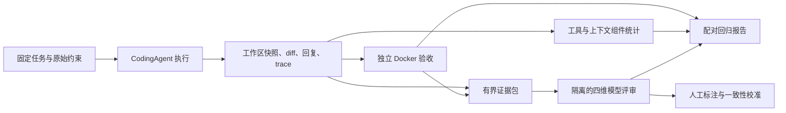

# XClaw 多层质量评测

在原有任务成功率评测上，增加四维 LLM-as-Judge、工具与上下文组件指标、配对回归和人工校准。
评测对象是 Coding Agent 的任务产物，不是校园问答平台；当前不提供意图识别准确率或 RAG Recall@k。

## 评测链路



`run_quality_case` 集成现有 `run_case`：真实 Agent 完成执行和独立验收后，单独调用 Judge。
对已经完成的实验，`xclaw-score judge` 直接评审已保存产物，无须重新生成代码。
Judge 没有工具注册表或执行权限，其 Token 用量独立记录，不计入 Agent 原有用量。

| 层次 | 回答的问题 | 判定来源 |
|---|---|---|
| 客观任务验收 | 任务是否正常结束、检查通过、修改路径合规？ | 原有独立测试与执行状态 |
| 四维质量 | 回复与实现是否相关、准确、完整、有用？ | 证据约束的模型评分，1–5 分 |
| 工具组件 | 调用是否执行成功、必要能力是否覆盖、是否重复相同参数？ | 工具事件与可选任务标注 |
| 上下文组件 | 输入是否保留、预算是否合规、早期约束是否仍在？ | 实际准备消息、估算长度、语义评审 |
| 回归与校准 | 新版本是否退步、模型评分与人工是否一致？ | 配对比较、人工标签 |

**任务成功率与四维分数分开报告。** 例如代码测试失败但回复很清楚，有用性仍可能获得一些分数，
但任务不能算成功。高分与失败冲突会进入人工复核标记。

## 四维评审与证据

评分规则位于 `src/xclaw/evaluation/judge.py`。四维分别为：

- 相关性：是否针对原任务，是否混入无关内容。
- 准确性：代码与陈述是否符合提供的证据，完成声明是否与检查结果一致。
- 完整性：是否覆盖任务要求和早期约束。
- 有用性：是否交付可用产物和清楚、可核验的说明。

通用锚点：1 分表示严重缺失或错误，3 分表示基本可用但存在明显缺口，5 分表示证据支持充分满足。
证据不足使用 `null`；报告同时显示评分覆盖率，不能把未知当作满分或零分。
逐项要求也输出 `true/false/null`，统计满足比例时同时报告可判断要求的覆盖率。

证据包包括原任务要求、最终回复、执行与验收结果、diff、有限长度的最终代码和工具轨迹。
隐藏参考实现和验收脚本不发给 Judge。方案标签、生成模型身份和汇总成绩不进入评分提示。
每个维度和要求须给出理由及逐字证据引用，程序检查引用来源、连续片段和要求 ID。
引用校验只能证明所引文本存在，不能证明模型解释正确；仍需人工校准。
超长或缺失证据会标注 `limited_sources`，不会假装全部内容已审查。

最多允许一次无效 JSON/引用修复重试；保存拒收输出与错误诊断，反馈原输出和准确来源片段。
测试日志以原始换行展示，避免 JSON 内层转义导致正确的多行引用误判。余额、鉴权等提供方错误直接停止。
调用前检查输入预算；API 原生 JSON 模式可通过 `--no-json-mode` 关闭，以适配其他兼容服务。
Judge 使用独立 `judge` 调用用途，DeepSeek 辅助调用关闭 thinking。

## 工具与上下文指标的口径

| 指标 | 解释与限制 |
|---|---|
| `tool_success_rate` | 正常完成工具调用 / 完成调用；不代表任务成功率 |
| `expected_tool_group_coverage` | 标注的能力组中，至少一项工具执行成功的比例；不等同工具选择准确率 |
| `repeated_argument_call_ratio` | 同次运行中重复工具名与规范化参数组合的比例；重复读取可能合理，不能称无效调用率 |
| `dependency_plan_fallback_rate` | 启用调度时无效计划退回比例；串行方案不适用 |
| `estimated_context_reduction_ratio` | 压缩事件前后估算长度的缩减；不等同实际 Token 节省或费用下降 |
| `semantic_constraint_retention_ratio` | 单独上下文实验中可判断约束的保留比例，须同时看覆盖率和人工校准 |

新 trace 使用每次运行独立的随机密钥对参数做 HMAC 指纹；只记录指纹，不记录原始参数或密钥。
旧的 288 次实验没有参数指纹，重复参数调用比例明确显示“不可测”。
工具组标注是人为定义的能力需求，允许不同实现路径，不能拿它替代独立验收。

## 命令

安装或刷新入口：`uv sync --extra office --group dev`。以下路径中的实验目录可替换为新实验。
离线组件分析不调用模型：

```powershell
xclaw-score analyze .xclaw/evaluations/live-20261012/2e3ca3c57fc048aca260130dca4d83ec --output .xclaw/quality/components
```

对已有产物进行有界抽样评审（默认最多 3 个案例）：

```powershell
xclaw-score judge .xclaw/evaluations/live-20261012/2e3ca3c57fc048aca260130dca4d83ec --config config.yaml --max-cases 3 --output .xclaw/quality/judgments
```

选样按任务类别和成功/失败分层轮转，不只挑成功案例。`--case-ids` 可明确指定样本。
`--judge-provider` 选择 `config.yaml` 中已有提供方，用于采用独立模型评审。
真实调用会把所选证据发送给该提供方；自定义仓库请先确认可发送的文件范围。
`--suite` 指定自定义任务集；任务可增加 `evaluation_requirements` 与 `expected_tool_groups`。

`--repeats 2` 用于检查评分稳定性；每次重复使用不同缓存键。
缓存按证据、规则、提供方身份、模型、输出上限、JSON 模式和重复编号隔离，
再次运行复用已通过校验的评分，不制造新增调用量。`--refresh` 强制重新评分。
报告包含逐项评分、理由、证据、建议、评分覆盖率、复核标记和 Judge 独立用量。
三样本演练只能验证链路，不能代表整个任务集的平均质量。

单独检查摘要和截断对早期语义约束的保留：

```powershell
xclaw-context-eval --config config.yaml --cases money --strategies summary truncate --judge --output .xclaw/quality/context-probe
```

内置三类约束：金额精度、公开接口约束、用户查找语义。它们是小型合成组件测试。
该命令调用真实上下文准备函数，保存最终消息；摘要会调用模型，`--judge` 另调用模型评审。
不带 `--judge` 时不生成语义保留率；截断本身不调用模型。

同任务与重复编号的回归比较：

```powershell
xclaw-score compare .xclaw/quality/baseline .xclaw/quality/candidate --baseline-variant summary_serial --candidate-variant summary_serial --output .xclaw/quality/regression.json
```

任务哈希不同的产物不可配对。质量分数比较还要求评分规则、模型与提供方身份、要求标注一致。
客观成功变失败和四维分数退步单独输出。重复评分记录不可混作独立任务；比较入口目前要求每个
任务/尝试只有一条评分记录，多次评分应先按重复编号拆分。

导出人工标签并校准：

```powershell
xclaw-score labels .xclaw/quality/judgments --output .xclaw/quality/human-labels.json
# 人工参照同一评分规则填写 1–5 分，不能直接复制模型分数。
xclaw-score calibrate .xclaw/quality/judgments .xclaw/quality/human-labels.json --output .xclaw/quality/calibration.json
```

标签默认全为 `null`，未标注时一致率也为 `null`。
输出逐维样本数、完全一致率、相差一分内比例、平均绝对误差、二次加权 Cohen's kappa。
同一个模型生成和评分存在偏好风险；自动分数不代表人工评审结论。

## 版本与现有实验

2026-10-13 已完成包含真实 Docker 验收的本地回归：**251 项通过、2 项因 Windows
符号链接权限跳过**。既有 **288 次尝试**均已完成离线组件分析，报告位于
`.xclaw/quality/component-audit-20261013/report.md`。
已获授权并完成 **3 个样本**的真实 DeepSeek 四维评分，引用复核全部通过，原任务验收结果未改变。
演练与修复记录见 [真实评分验证](QUALITY_EVALUATION_VALIDATION.md)。尚未人工标注，不报告人工一致率。

原 288 次真实模型实验结果保持原样，新增评分不修改其成功率与 Token 统计。
新增要求与工具组标注不进入原任务输入指纹，属于评测注释；评分另保存要求哈希。
本版本修正了截断路径“预算已经满足仍继续删历史”的行为，未来结果需注明版本并重新实验，
不能用新行为解释或改写原 73.6% / 87.5% 的结果。

## 参考

JSON 模式按 [DeepSeek 官方 JSON Output 文档](https://api-docs.deepseek.com/guides/json_mode/) 接入。
模型裁判可能存在位置、冗长与自我偏好，参见
[Judging LLM-as-a-Judge with MT-Bench and Chatbot Arena](https://arxiv.org/abs/2306.05685)。
因此本框架采用证据引用、隐藏方案标签、客观验收分离和人工校准，避免把模型分数当作确定事实。
